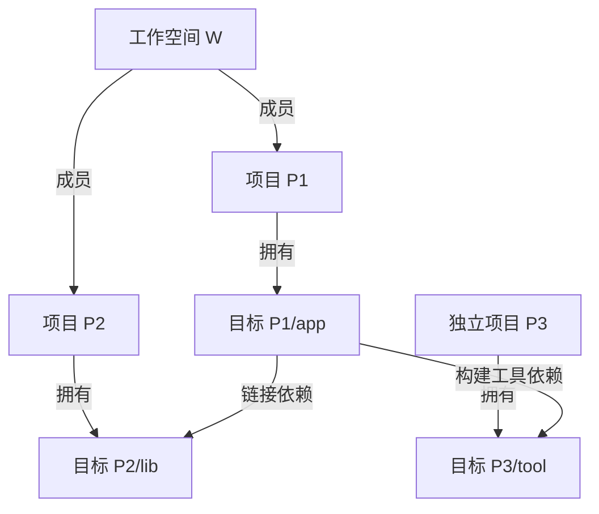

# 软件语义事实组织方式与多项目关系：Battle 讨论记录

日期：2026-11-01。状态：**proposed，待用户裁决**。

## 1. 讨论范围与执行证据

问题：软件项目语义事实模型是否应采用 DDD 领域模型组织？如何表达多个独立项目、工作空间和依赖？

参与者：领域建模、程序语义、工程结构、公共契约四个专业代理，分别以 fork_turns=none 独立上下文完成首轮；随后逐项交叉质询，共八份专业回复；第五个独立上下文代理完成综合评审。主代理整理争议和报告，不按人数投票。

共同输入为 software-semantic-domain-model.md 草案。各代理可以反驳草案，不把其概念边界作为已批准要求。主代理另核对一手文档。记录是论证摘要，不是逐字转储。通过当前平台通用协作工具显式分派角色；没有修改既有三角色配置包，也不宣称 Codex 自动加载了五个角色。

本轮只保存讨论记录，未修改领域模型、规格或实现。机器可读摘要见本文附录。

## 2. 建议结论

**采用 DDD 作为领域分析与设计方法，但不要求把事实集组织成 DDD 聚合树或 DDD 架构层。**

DDD 可用于统一术语、对象身份、职责与不变量。事实的公共逻辑表示则需要类型化主体、谓词与关系、值和行为结构、适用条件、主张模态、证据及覆盖信息。二者可以同时存在；DDD 不能替代事实目录、语法和操作语义。

不预先冻结“最佳层数”。工程包含、语义抽象、交叉分类、模型协作边界是不同维度。不能把战略、战术、应用、基础设施等分析工具设计概念当作所有被分析软件必有的语义层。

聚合和限界上下文保留为候选设计，依据真实一致性、独立演化和词义边界再确认。类型化关系结构也只是逻辑表达，不指定图数据库、存储模式或新造一门 IR 语言。

这是经反例质询形成的建议，不是“DDD必须采用”或“现模型已经完整”的证明。

## 3. 多项目关系的最小基线

| 概念 | 定义与边界 |
| --- | --- |
| Project | 有独立身份及明确工程边界的项目，可独立存在；项目识别规则仍需定义，不能仅凭路径或名称确定 |
| Workspace | 通过成员关系和协作配置组织项目；不是项目的强制父节点，不因目录嵌套自动产生 |
| Target | 项目独立定义的逻辑构建目标；项目可拥有多个目标，当前基线下每个目标一个项目归属 |
| Membership | 项目参与工作空间的显式关系，不转移目标所有权；工具成员约束与一般协作集合要区分 |
| DependencyRequest | 消费方声明需要哪个提供方、能力或发布坐标，保留条件和证据 |
| DependencyResolution | 在明确配置和解析范围下确定候选/提供方的结果；不得预设所有需求只对应一个全局结果 |
| OutputSpecification | 目标声明将产生什么，不说明已经构建成功 |
| ObservedArtifact | 已观察到的具体产物，附来源和上下文，不要求新增构建历史服务 |
| AnalysisScope | 此次分析或查询选取哪些对象，与项目所有权、成员关系和实体身份分开 |

关系建议：

- Project owns Target：归属，不是 DDD 聚合内嵌。
- Project member_of Workspace：成员，不是所有权。
- Target depends_on Target / Artifact / ExternalReference：有类型的依赖端点；服务和其他资源端点需按需求另行定义，不能塞入无类型字符串。
- CodeSubject participates_in Target under InterpretationContext：源码可复用，语义解释和引用必须保持上下文。
- Algorithm implemented_by CodeSubject：允许关联多个项目的操作；管理归属不等于参与范围。

这些关系不具有统一的默认传递性。P属于W、T属于P，不推出W拥有T；同工作空间也不推出项目相互依赖。



P3不必加入W。查询范围只包含P1和P2时，不能因P3在范围外删除依赖或强制把它加入W。

## 4. 依赖的精确表达

至少保留消费方、需求声明、提供方或候选、依赖种类、阶段、适用条件、解析上下文、证据及推导依据。

三个图要分开：项目级依赖、目标级依赖、代码语义关系。项目依赖可以来自声明，也可以由目标边汇总；汇总必须保留前提。不能将项目边广播到每个目标，不能将一次调用直接当作构建依赖。

**解析状态与范围位置正交。**

| 同一依赖D：P1/app → P3/tool | 解析状态 | 相对于本次范围的位置 |
| --- | --- | --- |
| 范围Q1只包含P1 | resolved | outside |
| 范围Q2包含P1、P3 | resolved | inside |

D及已解析端点身份不因改变查询范围而变化。scope需携带所相对的范围，通常在分析/查询结果中表达，不作为依赖身份。若解析受可见范围限制，则同时记录该解析范围与缺口，不能把局部未解析当成全局不存在。

声明依赖可以成环。只有在对应粒度、配置条件可同时满足时，才能判断某环可发生；项目汇总环不直接证明某目标构建环。环是否违规由明确的工程规则判断，不由模型删边“修正”。

## 5. 交叉质询中的关键修订

| 争议 | 首轮主张 | 第二轮及综合评审结果 |
| --- | --- | --- |
| C01 DDD组织方式 | DDD管理外壳、语义图与IR | DDD也参与概念设计；不固定聚合、数据库或新IR；公共契约优先 |
| C02 工作空间目标 | 工作空间聚合测试是目标归属反例 | 若只是选择成员目标，不构成反例；owner联合类型仅候选扩展，尚缺真实必要案例 |
| C03 Fact与Assertion | 新增主张记录及采信事实视图 | 撤回强制双轨；保留主张、条件、模态、证据和冲突，不默认裁真 |
| C04 Package | 包实体缺位 | 先区分命名空间、发布坐标与解析单元；只有独立身份需求成立才实体化 |
| C05 构建产物 | 增加规格、实例及执行实体 | 只确认声明输出与观察产物应区分，不增加执行历史服务 |
| C06 共享源码 | 需要语义实例 | 主体加条件可能足够；引用必须保持解释上下文，实例策略待反例验收 |
| C07 跨项目算法 | 单projectRef限制表达 | 管理归属与参与范围分开；无自然归属时规则待决，不复制算法或伪造工作空间 |
| C08 范围外依赖 | resolution/scope拆分 | 同意正交，并进一步明确scope相对查询/分析范围，不进入依赖身份 |

独立评审没有把这些局部收敛视为完整验证。尤其是项目身份、配置下引用与主张模态仍需具体规则。

## 6. 模态、行为与算法

规范要求、静态可能性和实际运行观测表达不同种类的主张，必须显式保留其模态、条件、量化范围和依据，不能只靠来源工具名字区分。互斥主张可并存，不能按置信度自动丢弃一方。

算法采用结构化行为描述和伪代码可读投影，关联输入输出、错误、副作用和实现主体。跨项目算法通过实现关联引用多个项目，不把项目聚合当作算法行为边界。伪代码结构完整不证明与实现等价；数值、求值、错误与并发语义仍需契约。

## 7. 尚未定稿及下一步验收

1. Project与包、清单、仓库的识别和身份连续性规则。
2. 工作空间是否存在需要自身拥有的独立目标，以及与选择器/编排任务的边界；没有证据时不扩展所有目标的归属类型，也不禁止以后扩展。
3. 同源码不同配置何时共享主体、何时需要上下文限定引用或展开实例身份。
4. 同一个依赖需求在多配置下解析到不同提供方的基数与身份。
5. 算法没有自然项目管理归属时的规则。
6. 语言机制映射不完整时，新增公共语义构造与记录缺口的边界。
7. 聚合/限界上下文的真实一致性和治理依据。

必要的验收用例：

| 用例 | 通过条件 |
| --- | --- |
| 两独立项目同名目标 | 身份隔离，跨项目依赖仍准确 |
| 同一工作空间内项目无依赖 | 只形成成员关系，不生成依赖 |
| 范围外已解析依赖 | 保留提供方身份，改变范围不改依赖身份 |
| 同声明D在T1为i32、T2为i64 | C引用D时可按解释上下文取得唯一对应类型，而非只给D堆两项事实 |
| 同一宏调用生成多项局部绑定 | 绑定引用和生成来源可区分、可追溯 |
| 同需求不同配置解析 | 结果与条件对应，不相互覆盖或误判冲突 |
| 跨项目协作算法 | 实现关联完整，不复制算法或制造工作空间 |
| 工作空间test命令 | 能区分选择器与独立定义单元，不凭命令名称创造目标 |
| 声明输出但未构建 | 不产生已观察产物的错误结论 |

## 8. 对原草案的修改建议与SDD接续

以下均为建议，本次未执行：

- §1、4、6、11、15：已定聚合/上下文/仓储语气改为候选；模型表达与实现组织分开。
- §7.2、§12和M05：解析状态与范围位置分开，已解析范围外对象不得退化为未知对象。
- §3、5、6：声明输出规格与实际观察产物分开。
- §15：算法管理归属、实现关联与参与项目分开；必填projectRef规则待确认。
- 增加本报告所列上下文、模态与多配置验收。

用户确认后，再通过OpenSpec变更形成规格及公共契约；Battle不替代变更、规格或验收。规格规定主体身份、谓词、条件、模态及证据约束；设计文件解释聚合、存储和事务选择。

## 9. 一手资料与证据边界

- [Eric Evans DDD Reference](https://www.domainlanguage.com/wp-content/uploads/2016/05/DDD_Reference_2015-03.pdf)：方法概念依据，不证明本项目必须使用某种聚合划分。
- [Cargo工作空间](https://doc.rust-lang.org/cargo/reference/workspaces.html)：工作空间组织包，可有无根包的虚拟清单，共同命令选择成员。只用于检验工程概念不能机械等同，不把Cargo模型普遍化。
- [CMake add_custom_target](https://cmake.org/cmake/help/latest/command/add_custom_target.html)：目标可不对应输出文件，说明目标和产物不能一一等同；它不证明工作空间拥有目标。

本文中的多配置、跨项目算法和工作空间报告汇总例子是设计验收反例或假设，不冒充已完成工具抽取和可执行验证。

## 附录：机器可读论证摘要

```json
{
  "battle_id": "semantic-model-2026-11-01",
  "problem": "是否采用DDD组织软件语义事实；如何表达独立项目、工作空间及依赖",
  "constraints": [
    "语言无关",
    "完整语义含算法伪代码",
    "多独立项目各自有目标",
    "工作空间组织多个项目",
    "分层不得预设",
    "只讨论不修改权威模型/规格"
  ],
  "evidence": [
    {
      "id": "D1",
      "path": "deliverables/software-semantic-domain-model.md",
      "sha256": "3ec7f1b153fa708bdc35882593824f3431753eed0fa6c1fd399315700203328c"
    },
    {
      "id": "E1",
      "url": "https://www.domainlanguage.com/wp-content/uploads/2016/05/DDD_Reference_2015-03.pdf"
    },
    {
      "id": "E2",
      "url": "https://doc.rust-lang.org/cargo/reference/workspaces.html"
    },
    {
      "id": "E3",
      "url": "https://cmake.org/cmake/help/latest/command/add_custom_target.html"
    }
  ],
  "acceptance_criteria": [
    "比较DDD与替代方案",
    "区分归属/成员/依赖/范围",
    "用反例验证条件依赖和多配置",
    "保留未决选择与证据边界"
  ],
  "decision_status": "proposed",
  "user_decision": null,
  "participants": [
    {
      "role": "ddd_domain_review",
      "context": "fork_turns=none"
    },
    {
      "role": "ddd_semantics_review",
      "context": "fork_turns=none"
    },
    {
      "role": "ddd_engineering_review",
      "context": "fork_turns=none"
    },
    {
      "role": "ddd_contract_review",
      "context": "fork_turns=none"
    },
    {
      "role": "ddd_final_review",
      "context": "fork_turns=none"
    }
  ],
  "rounds": [
    {
      "role": "ddd_domain_review",
      "round": 1,
      "position": "DDD可以采用但非必要；实体合理性依赖身份需求，聚合及三上下文划分尚早。",
      "evidence_refs": [
        "D1 §2,4,5,6,7,12,15"
      ],
      "counterexample": "批量导入后只读查询的类型化记录无需对象级事务即可表达多项目依赖。"
    },
    {
      "role": "ddd_semantics_review",
      "round": 1,
      "position": "类型化关系及行为结构承载语义，DDD不能限定跨项目和多配置行为；算法单projectRef有风险。",
      "evidence_refs": [
        "D1 §2,4,5,6,9,11,15"
      ],
      "counterexample": "同一声明在不同目标下为不同类型；跨项目协作算法不能被单项目归属截断。"
    },
    {
      "role": "ddd_engineering_review",
      "round": 1,
      "position": "质疑目标单项目归属，提出workspace目标、包及产物规格/实例。",
      "evidence_refs": [
        "D1 §3,5,6,7"
      ],
      "counterexample": "假设根工作空间定义聚合测试目标；此首轮反例第二轮被收缩为候选。"
    },
    {
      "role": "ddd_contract_review",
      "round": 1,
      "position": "DDD不能替代公共契约；解析和范围状态混杂；提出Assertion与Fact视图。",
      "evidence_refs": [
        "D1 §3,7,10,11,14,15,16"
      ],
      "counterexample": "唯一解析的范围外依赖无法由单个互斥状态同时表达。"
    },
    {
      "role": "ddd_domain_review",
      "round": 2,
      "responses": {
        "C01": "DDD不仅写入实现，也用于概念设计；不强制冻结聚合。",
        "C02": "workspace命令选择成员目标不证明新目标存在。",
        "C03": "采信视图有条件且可选，默认保留主张冲突。"
      }
    },
    {
      "role": "ddd_engineering_review",
      "round": 2,
      "responses": {
        "C02": "收回workspace拥有目标已证必要；独立声明与选择器分开，owner联合类型仅候选。",
        "C04": "包先消歧，发布坐标可作值对象，不立即增加实体。",
        "C05": "输出规格和观察产物分开，不必新增执行历史。",
        "C06": "共享来源，不强制合并语义主体；配置影响身份的规则待验收。"
      }
    },
    {
      "role": "ddd_semantics_review",
      "round": 2,
      "responses": {
        "C01": "图/IR只指逻辑表达，不要求图数据库或新IR语言。",
        "C06": "主体加条件可能足够；上下文限定引用与展开实例应由反例验证。",
        "C07": "算法管理归属与参与项目分开，无自然归属不能伪造项目。",
        "C03": "保留规范、静态可能和运行观测的模态，不自动互判真假。"
      }
    },
    {
      "role": "ddd_contract_review",
      "round": 2,
      "responses": {
        "C03": "撤回强制Assertion/Fact双轨；主张、条件、证据和冲突即可。",
        "C08": "scope相对查询/分析范围，不进入依赖身份；解析范围另外记录。",
        "C01": "规格固定公共语义；聚合、仓储及存储引擎留设计。",
        "C06": "内容标识检查当前来源有效性，不增加历史查询。"
      }
    }
  ],
  "disputes": [
    {
      "id": "C01",
      "topic": "DDD采用边界",
      "result": "建议用于概念和规则设计，不作为语义分层或强制对象嵌套结构"
    },
    {
      "id": "C02",
      "topic": "workspace是否拥有目标",
      "result": "未证实为通用需求，命令选择器不算新目标；保留真实反例驱动扩展"
    },
    {
      "id": "C03",
      "topic": "主张与采信",
      "result": "不引入强制双轨，不自动裁决"
    },
    {
      "id": "C04",
      "topic": "包是否立即实体化",
      "result": "先区分不同含义"
    },
    {
      "id": "C05",
      "topic": "产物与执行历史",
      "result": "区分声明/观测，不增加历史服务"
    },
    {
      "id": "C06",
      "topic": "多配置身份",
      "result": "需要上下文可保持的引用；实例策略待定"
    },
    {
      "id": "C07",
      "topic": "跨项目算法",
      "result": "管理归属与参与范围分离"
    },
    {
      "id": "C08",
      "topic": "解析与范围状态",
      "result": "正交表达，范围不构成依赖身份"
    }
  ],
  "unresolved": [
    "Project与Package的精确识别边界",
    "workspace独立目标是否存在适用的真实案例",
    "配置和宏展开何时需要独立主体身份",
    "跨项目算法无自然管理归属时的身份规则",
    "聚合与限界上下文的实际一致性和治理依据",
    "依赖解析是相对于哪个配置和可见范围"
  ],
  "record_kind": "主持人整理的论证摘要，不是逐字会话转储",
  "runtime_note": "使用当前平台通用协作工具显式传入专业角色；未修改三角色配置包，也未验证Codex角色自动加载。",
  "review": {
    "role": "ddd_final_review",
    "status": "proposed",
    "recommendation": "采用DDD澄清领域概念与规则；以类型化主体/关系/条件/证据及结构化行为表达事实，不把聚合和分层当成通用语义骨架。",
    "residual_findings": [
      "项目身份与重叠边界仍缺判据",
      "仅附条件不保证引用保持解释上下文",
      "主张模态必须显式，伪代码结构完整不证明实现等价"
    ],
    "required_examples": [
      "同主体多目标异型",
      "重复宏展开",
      "同依赖换范围",
      "同需求多配置解析",
      "跨项目算法"
    ],
    "changes_are_proposals_only": true
  },
  "recommendation": "采用DDD澄清领域概念与规则；以类型化主体/关系/条件/证据及结构化行为表达事实，不把聚合和分层当成通用语义骨架。"
}
```
