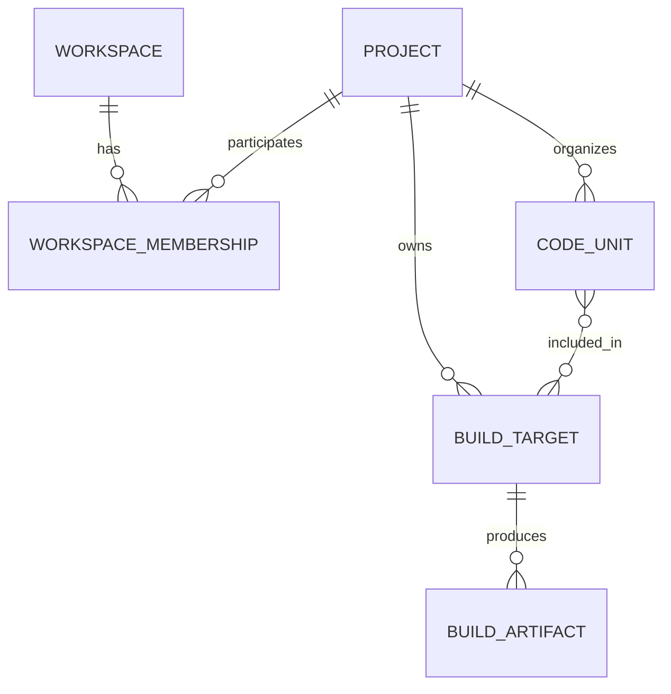
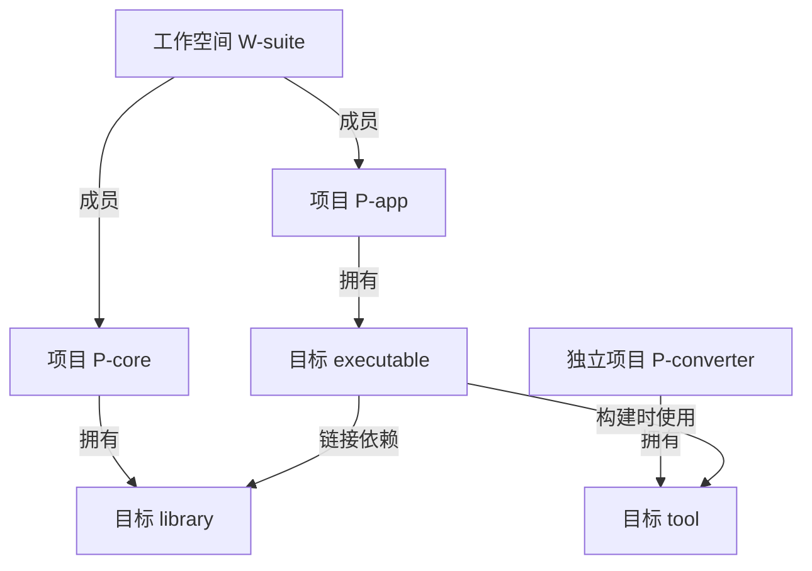

# 软件项目语义事实领域模型设计与定义

文档性质：领域设计草案，供评审；不是现有实现说明，也不是 DDD 标准本身。

## 1. 目标与依据

本模型旨在完整表达一个或多个软件项目当前可获取、可追溯的软件语义事实，涵盖工程结构、构建、代码、接口、算法、状态、运行协作和交付约束及其相互关系。完整表达是模型的覆盖目标，不意味着仅凭源码即可获取需求意图、所有运行行为或证明任意程序的性质。模型必须支持独立项目、多个项目组成的工作空间、跨项目依赖和混合语言项目，并使每项语义陈述具有明确的适用条件和依据。

设计采用 DDD 的统一语言、限界上下文、实体、值对象和聚合等概念。DDD 是设计方法，不规定软件语义事实应分成几层。本文后续的分类、实体和规则均为针对本领域提出的设计选择，不能视为 DDD 的通用规范要求。

参考：Eric Evans，[*DDD Reference: Definitions and Pattern Summaries*](https://www.domainlanguage.com/wp-content/uploads/2016/05/DDD_Reference_2015-03.pdf)；[官方说明页](https://www.domainlanguage.com/ddd/reference/)。

## 2. 三种边界必须分开

| 边界 | 回答的问题 | 例子 |
| --- | --- | --- |
| 分析工具的职责划分 | 由哪个组件提供能力 | 模型规则、事实查询、数据存储、工具接入 |
| 语义事实的内容分类 | 被分析的软件具有什么语义 | 项目成员、目标依赖、类型约束、调用行为 |
| 被分析项目自身的架构 | 该软件采用了什么组织方式 | 分层架构、插件架构、DDD、单体应用 |

分析工具采用 DDD，不意味着被分析项目必须采用 DDD。不能仅凭目录名为 `domain`、`application` 或 `infra` 就断言该项目具备相应领域边界或依赖规则。架构角色可以作为带证据的事实记录，不作为所有项目的强制骨架。

### 2.1 替代原有名称的工程职责术语

原有五个名称混合了设计活动与实现职责，不宜作为语义事实层级。若描述分析工具自身，采用下表的工程名称：

| 原名称 | 建议名称 | 实际职责 |
| --- | --- | --- |
| 战略层 | 领域边界与模型协作设计 | 定义统一语言、限界上下文及模型协作关系；属于设计活动，不强制设成运行时层 |
| 战术领域层 | 语义对象与规则模型 | 定义实体、值对象、聚合及领域不变量 |
| 应用层 | 事实处理与查询编排 | 协调获取、转换、提交和读取用例 |
| 基础设施层 | 存储与工具适配 | 接入解析器、构建工具、文件系统和持久化服务 |
| 接口层 | 请求接入与结果呈现 | 接收查询、输出结构化结果和可读报告 |

保留 DDD 术语用于准确说明方法；对组件、目录和设计章节使用上述职责名称。该映射不表示 DDD 要求五层架构，也不表示被分析项目拥有五个同名层次。

### 2.2 语义事实的工程分类

描述被分析软件时，采用以下内容分类。它们是可交叉关联的语义视图，不是严格的包含树或固定流水线。

| 分类 | 主要问题 | 代表对象或事实 |
| --- | --- | --- |
| 工程组织与构建 | 有哪些工程单元，如何组成和构建 | 项目、工作空间、成员、构建目标、产物、构建条件、依赖 |
| 代码组织与可见性 | 声明如何组织，哪些主体可以访问 | 模块、声明、命名空间、包含、导出、访问约束 |
| 接口与类型契约 | 接受什么、返回什么、必须满足什么 | 类型、操作、参数、结果、约束、错误契约 |
| 实现行为与数据关系 | 如何计算和改变状态 | 操作区域、控制关系、数据依赖、读写、调用、异常传播 |
| 运行协作与外部交互 | 与哪些执行主体和环境协作 | 并发、同步、生命周期、资源、文件与网络交互 |

来源、证据、适用条件及认知状态贯穿全部分类。测试、示例和基准可以具有自己的构建目标，也可以包含行为证据；不把它们强制归入一个独立语义层。

## 3. 统一语言

| 术语 | 定义 | 必须区分的概念 |
| --- | --- | --- |
| 分析范围 AnalysisScope | 一次事实分析或查询明确选定的项目、工作空间及可见外部引用范围 | 是观察边界，不制造项目所有权 |
| 项目 Project | 在模型中具有独立身份、明确工程边界、拥有自身构建定义或代码组织定义的软件工程单元 | 不等同于 Git 仓库、文件夹、包名或部署服务 |
| 工作空间 Workspace | 具有明确成员及协作配置的项目组织单元 | 项目可以不属于工作空间；任意项目集合不自动成为工作空间 |
| 工作空间成员 WorkspaceMembership | 某项目以特定角色加入某工作空间的关系 | 表示组织关系，不转移项目及其目标的所有权 |
| 构建目标 BuildTarget | 项目中可由构建系统识别并独立选择、组合或执行的逻辑构建单元 | 不等同于目标平台，也不等同于输出文件 |
| 构建产物 BuildArtifact | 在给定构建条件下由目标产生的库、程序、包、生成文件等结果 | 一个目标可产生零个或多个产物 |
| 构建上下文 BuildContext | 影响构建与语义解释的一组已知配置条件 | 包括平台、特性、配置、语言模式等，不是目标身份本身 |
| 外部工程引用 ExternalReference | 尚未纳入当前范围或无法解析为本地实体的依赖对象描述 | 不得据此伪造本地项目或构建目标 |
| 语义主体 SemanticSubject | 可被事实陈述的工程或代码对象的统称 | 是概念总称，不要求所有对象继承同一实现基类 |
| 语义事实 SemanticFact | 在明确条件下，对主体作出的有类型、有依据的陈述 | “事实记录”可承载待确认主张，不保证每项主张都为真 |
| 依赖 Dependency | 消费方依赖提供方的显式、有方向关系 | 不等同于包含、同工作空间或目录相邻 |
| 来源 Source | 产生观察或推导依据的信息载体及定位 | 源码、清单、解析输出、构建记录、测试记录等 |
| 证据 Evidence | 支持、反驳或限定事实主张的来源片段及解释 | 工具名称本身不足以证明结论 |

项目识别依据应记录为事实：例如清单定义、构建入口或用户明确指定的工程边界。仅发现多个文件夹，不能断定发现多个项目。仅发现同一仓库中的多个目标，也不能断定每个目标都是独立项目。

## 4. 领域边界与模型协作

本设计以“软件语义事实”为核心领域，建议划分以下模型上下文；这是语义职责边界，不要求实现为多个微服务。

| 限界上下文 | 权威概念与职责 | 与其他上下文的关系 |
| --- | --- | --- |
| 工程与构建结构 | 项目身份、工作空间成员、目标归属、声明依赖、构建配置 | 向代码语义提供工程引用；不根据代码调用倒推构建声明 |
| 程序语义 | 模块、声明、类型、操作、行为、资源与交互 | 使用工程身份；保留代码存在条件和目标关联 |
| 事实依据与认知状态 | 来源、证据、覆盖范围、解析缺口、互斥主张 | 通过主体与事实引用关联前两者，不改写其专业语义 |

三者通过共同维护的最小引用协议交换身份、事实引用和条件表达式；各自保留专业词汇，不把所有模型塞入一个万能实体。各语言和工具的输出在适配边界转换，公共模型不直接依赖其 AST、符号编号或诊断文本格式。

存储服务是上述模型的持久化能力；查询编排是用例协调能力。二者不因存在独立组件就自动成为新的业务限界上下文。语义正确性规则由模型及相应处理能力负责，存储实现不自行补造事实或推断缺失状态。

## 5. 核心结构与基数



图中的“拥有”是领域归属，不等同于 DDD 聚合内嵌。跨聚合按身份引用，不加载整个项目对象图。

核心规则：

1. 每个构建目标恰好属于一个项目。目标不能以加入工作空间为由转属工作空间。
2. 一个项目可以有零个或多个目标。零个目标可能代表源码工程、未获取目标信息或确实无构建定义，必须由覆盖状态区分。
3. 工作空间通过成员关系关联项目，不复制项目和目标。目标唯一性在项目边界内确定，全局引用必须携带项目身份。
4. 公共模型允许一个项目参与多个协作工作空间；具体工具不允许时，由工具约束表达，不能抹除通用模型的表达能力。
5. 工作空间可以包含其他工作空间的组织引用，以表达嵌套协作；该关系不自动继承项目成员，也不重写项目归属。成员展开规则必须显式指定，结构包含不得形成循环。
6. 嵌套目录不是成员证明；同目录的工作空间与项目也不是同一实体。
7. 项目之间可以存在依赖而没有共同工作空间。分析范围可以直接选择这些独立项目。
8. 代码单元和目标是多对多关系：同一源码可参与多个目标；目标也可引用生成代码或外部代码。

## 6. 实体、值对象与聚合

### 6.1 实体定义

| 实体 | 核心字段 | 身份与约束 |
| --- | --- | --- |
| Project | projectId、name、engineeringBoundary、sourceRefs | projectId 稳定；目录和名称是属性，不作为唯一身份 |
| Workspace | workspaceId、name、configurationRefs、memberSet | 成员由根统一管理；项目事实仍独立存在 |
| BuildTarget | targetId、projectRef、name、purpose、outputKinds、definitionRefs | targetId 在项目内唯一；projectRef 必填 |
| BuildArtifact | artifactId、producerTargetRef、buildContextRef、artifactKind、location | 记录具体产物时不能仅按文件名判等 |
| CodeUnit | unitId、projectRef、kind、name、sourceRefs | 可为模块、命名空间或其他组织单元，不强制对应文件 |
| Declaration | declarationId、projectRef、unitRef、kind、name、condition | 覆盖类型、操作、变量等命名或匿名声明 |
| BehaviorRegion | regionId、projectRef、operationRef、regionKind | 表达操作内的行为区域；可关联源码、展开或推导证据 |
| Dependency | dependencyId、sourceRef、requestedProvider、resolvedProvider、phase、condition、basis | 区分声明需求与解析结果；允许存在多条条件不同的边 |
| SemanticFact | factId、subjectRef、predicate、value、applicability、evidenceRefs | 同一主体可存在多项互斥主张；不可仅按谓词覆盖 |
| SourceRecord | sourceId、locator、contentDigest、sourceKind | 摘要识别所用内容，不替代主体身份 |
| EvidenceRecord | evidenceId、sourceRefs、locator、method、supportRole、premiseFactRefs | 推导证据记录前提和方法，观察证据记录直接来源 |

字段是概念定义，尚非可执行 JSON Schema。实现阶段还需确定基数、编码和验证规则；不得把示例直接当作完整序列化协议。

### 6.2 值对象

| 值对象 | 含义与约束 |
| --- | --- |
| SubjectRef | 类型化主体引用；项目内对象至少包含 projectId、kind、localId；工作空间等对象使用自己的归属域 |
| WorkspaceMembership | projectRef、role、condition、evidenceRefs；成员配置中的角色不改变项目身份 |
| SourceLocator | 来源记录与可定位区域；区域可为文本位置、构建清单条目、工具节点或非源码记录 |
| Applicability | 主张成立的配置和条件；区分恒真、恒假、条件表达式及未知条件 |
| DependencyEndpoint | 项目、构建目标、产物或外部引用的带类型联合，不能用任意字符串混用 |
| DependencyRequest | 来源中声明的提供方名称、范围、能力、版本约束及定位 |
| TypeExpression | 类型构造与约束的结构化表达，可引用命名类型或组合类型 |
| AccessConstraint | 允许访问的主体集合或判定条件，如模块、项目、指定友元、外部调用者 |
| EffectDescription | 对状态、资源、外部环境及可观察行为的影响 |
| CoverageAssessment | 针对明确对象、事实种类与构建条件的覆盖结论及缺口 |

值对象按内容判等，实例被修改时以新值替换。实体按身份区分，改名、移动或属性变动不应自动产生新主体身份；无法证明身份连续时必须报告对应缺口。

### 6.3 聚合划分

| 聚合根 | 管理内容 | 局部一致性规则 |
| --- | --- | --- |
| Project | 项目描述、边界与工程识别依据 | 身份与工程边界不得互相矛盾 |
| Workspace | 工作空间配置、成员值对象、嵌套工作空间引用 | 同一条件和角色下无重复成员；成员变更保持集合规则 |
| BuildTarget | 目标定义、用途、输出类别、构建条件 | 一个项目归属；目标内部配置引用一致 |
| SemanticFact | 单项主张、适用条件、证据引用 | 主体类型、谓词类型和值类型匹配；替代关系明确 |
| Dependency | 一项依赖声明及对应解析状态 | 消费方明确；解析端点与状态一致，不凭空补全 |
| EvidenceRecord | 来源定位、方法、支持角色、推导前提引用 | 证据类型所要求的字段齐全 |

代码实体、产物等可以采用独立聚合，以避免把整个代码库放进 Project 聚合。具体写入事务边界由实现设计确定，不能从图中的包含边机械推导。

跨聚合规则（如目标引用的项目是否存在、工作空间包含是否成环）由领域服务和提交协调校验，不宣称单个聚合可独立保证。允许范围外引用时，只要求外部引用描述有效，不要求把外部对象完整装载。

## 7. 依赖模型

### 7.1 方向、粒度与依据

统一采用“消费方 → 提供方”。至少区分以下关系：

| 关系 | 端点 | 意义 |
| --- | --- | --- |
| 项目依赖 | Project → Project 或 ExternalReference | 工程定义声明的项目级依赖 |
| 目标依赖 | BuildTarget → BuildTarget、BuildArtifact 或 ExternalReference | 具体目标需要哪个目标或产物 |
| 代码语义依赖 | Declaration / BehaviorRegion → Declaration 等 | 调用、类型使用、读写等；按具体谓词区分 |

项目依赖可能直接来自构建清单，也可能是目标依赖的汇总视图。二者必须记录不同的依据类型；汇总事实还应保留前提边引用。不能把项目依赖无条件分配给该项目的每个目标，也不能从一次函数调用直接断言存在构建依赖。

### 7.2 依赖属性

- `phase`：构建准备、编译、链接、运行、测试、打包等，可为集合；这些维度不互相排斥。
- `usage`：使用库、执行工具、加载插件、消费生成资源等，表达依赖的用途。
- `condition`：目标平台、特性开关及配置条件；未知条件不可当作恒真。
- `requestedProvider`：来源声明的需求；`resolvedProvider`：实际解析出的对象，可尚未给出。
- `resolutionState`：resolved、unresolved、ambiguous、outside_scope；范围外状态可以携带已知外部身份，但不冒充已纳入范围的本地目标。
- `basis`：declared、observed 或 derived，并附证据或推导前提。

不把 `dev`、`implementation` 等工具专用标签直接作为公共枚举；适配器将其映射为公共用途、阶段、条件与传播属性，同时保留原标签依据。

### 7.3 循环与构建上下文

声明图可以包含循环，应如实表达。是否违反构建规则，应在特定构建系统和上下文下判断。项目级汇总图成环，不足以证明某个目标构建图成环；不同互斥条件下的边也不能直接拼成实际可发生的环。

构建上下文至少可记录主机平台、产物平台、配置、特性取值、语言模式及其他影响条件。交叉编译时主机平台与产物平台分开；工具型目标可能为主机生成。抽象条件保留结构化表达，无法解释的工具条件保留原始依据并标注未规范化部分。

## 8. 程序语义内容

语言无关不意味着把所有代码都转换成“类和方法”。公共模型应支持以下构造：

| 内容 | 公共表达 | 保留的区别 |
| --- | --- | --- |
| 声明组织 | 组织单元、包含、命名、导入、导出 | 文件布局与语义包含分开 |
| 类型 | 名义类型、结构类型、组合类型、类型参数、约束 | 类型名称相同不代表等价；整数宽度、符号与溢出语义需显式表达 |
| 操作接口 | 参数模式、结果、前后置条件、错误、效果 | 自由函数、成员操作、闭包可保留调用方式差异 |
| 可见性 | AccessConstraint 与访问主体范围 | 不把 internal 等词统一映射成没有上下文的等级数字 |
| 控制行为 | 顺序、分支、迭代、退出、异常传播、挂起与恢复 | 区分源码结构与分析得到的控制关系 |
| 数据关系 | 定义、使用、读写、数据依赖、别名、捕获 | 值传递、共享引用、可变访问等区别不丢失 |
| 资源与状态 | 状态变更、分配、释放、借用、生命周期约束 | 以可表达的约束建模，不把某种语言机制当作所有语言前提 |
| 外部效果 | 文件、网络、进程、时钟、随机源及其他资源交互 | 没有发现效果不能直接证明纯函数 |
| 并发协作 | 执行主体、同步、消息、共享状态、顺序约束 | 静态可能性与运行观测分开 |

算法描述是本模型的必要表达能力。算法不能只以名称、功能摘要或调用关系代替；其领域定义、伪代码表示和与实现的关联见第 15 节。算法描述不要求与函数一一对应：一项操作可实现多个算法片段，一个算法也可由多个操作协作实现。

## 9. 语言无关的转换规则

### 9.1 公共语义与来源表示分离

公共事实使用语言无关的主体、谓词和值结构；来源记录可以携带语言、工具和原始语法信息。这些来源字段服务于追溯，不成为公共语义解释的前提。

适配过程必须区分三种结果：

1. 可准确映射：产生公共语义事实并附依据。
2. 只能部分映射：产生可确认部分，同时记录未表达部分和影响范围。
3. 无法映射：保留来源与缺口，不以空值或任意文本冒充完整公共语义。

不提供可绕过公共词汇的任意 `extensions` 事实袋。新公共谓词或类型构造必须定义含义、约束和证据要求；尚未建模的语言机制只保留来源及明确缺口。

### 9.2 语言机制示例

| 来源机制 | 可表达的公共语义 | 不能直接推断的内容 |
| --- | --- | --- |
| 宏或编译期生成 | 源码调用、展开产物、生成声明、生成行为及来源映射 | 不掌握展开结果时，不能声称行为已完整获知 |
| 注解或元数据 | 附着声明的元数据；经证实的生成、注册或运行效果 | 注解名字不等于实际运行效果 |
| Lambda / 闭包 | 匿名操作、参数、捕获、调用与效果 | 捕获方式和共享状态需有依据 |
| 条件绑定与解糖 | 取值、判定、绑定、分支和后续使用 | 工具未返回调用边，不能据此断言调用不存在 |
| 不同语言的访问修饰符 | 基于可访问主体和边界的访问约束 | `internal`、包可见和模块可见不能仅按名称等同 |

一个源码位置可以对应多个语义操作，多个源码位置也可能对应同一展开行为。证据定位必须允许零个直接源码区间，并通过展开记录、工具节点或推导前提继续追溯；缺少定位时如实记录。

## 10. 事实、证据与缺口

建议事实采用以下概念结构：

```text
SemanticFact = {
  factId,
  subjectRef,
  predicate,
  value,
  applicability,
  basis,
  evidenceRefs
}
```

这里的文本表示字段集合，不是图示，也不指定实现语言。关联事实可将类型化引用作为值；复杂事实可引用其他事实，不要求一次展开全部事实。

覆盖和冲突独立建模，避免在一项事实上使用含义混杂的 `status`：

| 对象 | 含义 |
| --- | --- |
| CoverageAssessment | 指定主体、事实类别和条件下，观察范围是否已覆盖，以及未覆盖原因 |
| GapRecord | 缺失信息、受影响对象、原因及影响；例如目标依赖无法解析、宏未展开 |
| ConflictRecord | 在重叠条件下无法同时成立的主张引用及冲突原因；不自动裁决 |
| EvidenceRecord | 支持、反驳或限定主张的具体依据及方法 |

区分“已确认没有”“未获取”“不支持”“不适用”。只有完成相关范围的检查并取得否定依据，才能表达不存在。`null` 仅代表字段未携带值，不能单独证明上述任一状态。

来源内容摘要用于检查事实对应的是哪份输入。它不提供项目身份，也不意味着系统必须支持历史查询或用户快照。事实有效性应相对于明确的当前输入和构建上下文判断。

## 11. 领域服务、仓储与协作规则

| 领域能力 | 输入与输出 | 责任边界 |
| --- | --- | --- |
| 工程身份协调 | 工程识别依据 → 身份关联或歧义 | 不以路径相似或内容相同直接合并项目 |
| 成员关系校验 | 工作空间与成员 → 约束结果 | 目录发现与成员确认分开 |
| 目标依赖解析 | 声明、目标与上下文 → 解析边或缺口 | 不从项目依赖补造目标边 |
| 条件求值 | 条件与上下文 → 真、假或未知 | 不把未知当作真或假 |
| 依赖图分析 | 指定粒度与条件的图 → 可达关系、环及依据 | 派生结果记录输入关系，未知条件限制结论 |
| 语义映射 | 工具输出与映射规则 → 公共事实及缺口 | 不把工具模型直接暴露为领域定义 |
| 一致性评估 | 事实与证据 → 冲突、缺口或通过结果 | “结构合法”与“语义正确”分开 |

仓储抽象按聚合提供保存、按身份读取和提交能力，不在仓储中调用编译器、解析源码或裁决事实。跨项目图查询可使用专门的读取模型，但必须保留原主体身份、适用条件、证据和缺口。

领域事件可包括“工作空间成员已确认”“构建目标已识别”“依赖解析已完成”“事实冲突已识别”。它们是分析系统发生的领域变化，不等同于被分析程序的运行事件。本文不要求事件溯源或历史保留。

## 12. 多独立项目与工作空间案例

以下全部为虚构、语言无关的工程数据，用于检验表达能力。

| 项目 | 项目身份 | 自有目标 | 工作空间成员关系 |
| --- | --- | --- | --- |
| core | P-core | library、unit-test | W-suite |
| app | P-app | executable、integration-test | W-suite |
| converter | P-converter | tool | 无 |



P-converter 不属于 W-suite，但 P-app 的目标仍可依赖其工具目标。分析范围若包含三个项目，则可使用跨项目目标引用；范围只包含 W-suite 的成员时，该依赖以范围外引用表达，不能删除该边或强行把 converter 加入工作空间。

目标依赖示例（概念级 JSON；短 ID 仅用于演示）：

```json
{
  "dependencyId": "D-app-core",
  "sourceRef": {
    "kind": "build_target",
    "projectId": "P-app",
    "localId": "executable"
  },
  "requestedProvider": {
    "name": "core",
    "requiredOutputKind": "library"
  },
  "resolvedProvider": {
    "kind": "build_target",
    "projectId": "P-core",
    "localId": "library"
  },
  "resolutionState": "resolved",
  "phase": ["link"],
  "usage": "consume_library",
  "condition": {"kind": "constant", "value": true},
  "basis": "declared",
  "evidenceRefs": ["E-build-config-1"]
}
```

示例目标登记表还包括 unit-test 和 integration-test，但图中仅显示当前讨论的三个目标。没有给出的测试依赖不能被推断为已知或不存在。

假设某配置下 `P-app/executable → P-core/library`，另一配置下出现反向依赖，只有在条件可同时满足时才能判断形成可发生的循环。分析工具需保留两条边及条件，不能以“构建图必须是 DAG”为由删除其中一条。

## 13. 模型验收场景

| 编号 | 场景 | 应得到的表达 |
| --- | --- | --- |
| M01 | 两个独立仓库各有名为 library 的目标 | 两个项目身份、两个目标引用，不因同名合并 |
| M02 | 一个项目有程序、库、示例、测试、基准目标 | 一个项目与多个目标，角色与输出种类分开 |
| M03 | 工作空间有多个项目 | 显式成员关系；目标仍归各项目 |
| M04 | 两个独立项目互相依赖但无工作空间 | 直接记录依赖，不创建虚构工作空间 |
| M05 | 工作空间项目依赖范围外工具目标 | 保留外部身份或需求与 outside_scope，不强制纳入成员 |
| M06 | 项目成员和目标构建条件不同 | 成员条件、目标条件与依赖条件分别保留 |
| M07 | 两个项目存在循环声明 | 保存原始边；在给定上下文中评估是否违规 |
| M08 | 一份源码供多个目标使用 | 多个目标关联同一代码主体及各自适用条件 |
| M09 | 混合语言项目 | 一个项目可关联多种语言来源，公共事实不按语言复制 |
| M10 | 宏未展开或调用归属无法定位 | 保留可见事实及证据缺口，不报告调用不存在 |
| M11 | 工具只能解析到项目级依赖 | 保留项目级关系，不生成猜测的目标级关系 |
| M12 | 空目标列表但未做目标识别 | 覆盖状态为未获取，不能解释为无目标 |
| M13 | 项目移动或改名 | 已有身份依据充分时维持身份，否则报告歧义 |
| M14 | 不同工具给出互斥事实 | 保存各自主张和证据，并关联冲突记录 |
| M15 | 同一目录有嵌套工程和工作空间 | 分别识别工程边界、显式成员与组织引用，不按路径自动归属 |
| M16 | 被分析项目不是 DDD 架构 | 正常表达其代码与构建语义，不强制创造领域层或聚合 |

## 14. 后续公共定义的落地边界

本设计可以作为事实目录、类型化主体引用、查询请求与查询结果契约的依据。下一阶段需将谓词、字段类型、基数、条件表达式、状态取值、身份规则及上述验收场景转化为可执行的公共契约。

在这些契约确认前，本文不指定数据库表、图数据库、解析工具或实现语言，也不宣称已经完成跨语言语义等价证明。实现选型必须服从领域含义与证据边界，而不能反过来用某个工具的数据结构限定公共模型。


## 15. 算法领域模型与伪代码表达

### 15.1 定义与边界

**算法描述 AlgorithmDescription**：针对明确的问题、输入、输出与适用条件，对计算步骤、决策、迭代、数据变换和可观察效果作出的语言无关描述。它是语义模型中的一级概念，支持检索、引用、关联证据和报告缺口；不只是函数旁的一段自由文本。

区分三种描述目的：

| 类型 | 陈述内容 | 所需依据 |
| --- | --- | --- |
| 算法规范 | 要解决的问题与允许的行为 | 明确的规范、需求或已确认契约 |
| 实现算法描述 | 当前实现实际采用的步骤与行为 | 源码、展开结果、编译分析及其他实现证据 |
| 抽象算法解释 | 对实现进行简化后的计算解释 | 实现证据、抽象规则及省略项 |

实现中发现的异常行为或缺陷也必须忠实保留。不能以常见算法名称推断当前实现正确，更不能把“应当如此”的规范伪装成“已经如此”的实现事实。

### 15.2 对象定义

| 对象 | DDD 角色 | 定义及主要字段 |
| --- | --- | --- |
| AlgorithmDescription | 实体、聚合根 | algorithmId、projectRef、name、descriptionKind、problem、inputContract、outputContract、preconditions、postconditions、body、applicability、implementationRefs、evidenceRefs |
| AlgorithmStep | 聚合内部实体 | stepId、operationKind、operands、resultBindings、nestedRegions、evidenceRefs；stepId 在算法内唯一 |
| AlgorithmRegion | 聚合内部实体 | regionId、regionKind、有序步骤或控制结构；表示分支、循环体、异常处理和并发区域 |
| AlgorithmContract | 值对象 | 输入域、结果、错误、状态、效果、前后置条件；未确认项明确引用缺口 |
| AlgorithmImplementationLink | 关系实体 | 算法引用、实现主体引用、对应区域、对应方式、适用条件与证据；独立管理跨算法和代码主体的关联 |
| StepRef | 值对象 | algorithmId 与 stepId，供数据关系、控制关系和证据映射使用 |
| AlgorithmProperty | 语义事实 | 终止性、循环不变量、复杂度、确定性、正确性等主张，均附条件和依据 |

算法根负责内部步骤身份唯一、变量作用域、内部引用和结构完整性。引用其他算法、操作或代码区域时，按身份引用，不把所有相关实现并入一个聚合。

复杂度主张必须注明输入规模参数、成本模型、最坏/平均等类别，以及假设。仅识别出循环不能直接断言复杂度；缺少证明时保留推断性质和限制。

### 15.3 伪代码是结构化模型的可读投影

算法体使用有类型的步骤和表达式结构保存，伪代码由该结构生成，并通过步骤标记关联证据。可读投影不得省略会改变行为判断的数值规则、错误路径、状态变化或求值顺序。

| 构造 | 伪代码表示 | 必须保留的语义 |
| --- | --- | --- |
| 绑定与赋值 | LET、SET | 新绑定与修改已有位置分开；作用域与别名明确 |
| 表达式计算 | COMPUTE | 操作数类型、求值顺序、数值规则与可能失败 |
| 条件分支 | IF / ELSE | 条件、分支次序、条件求值的副作用 |
| 迭代 | WHILE、FOR EACH | 遍历顺序、循环条件、退出方式、集合变动语义 |
| 调用 | CALL | 被调用主体、参数传递、结果、错误与效果 |
| 退出 | RETURN、BREAK、CONTINUE | 返回值与目标控制区域 |
| 错误 | RAISE、TRY / HANDLE、结果值分支 | 异常、错误返回、终止进程等机制不能混同 |
| 状态与资源 | READ、WRITE、ACQUIRE、RELEASE | 操作对象、时机、顺序和生命周期 |
| 并发 | SPAWN、AWAIT、SEND、RECEIVE、ATOMIC | 执行主体、同步和允许的事件顺序 |
| 动态选择 | DISPATCH / CHOOSE | 候选集、选择条件与尚未解析部分 |
| 未知区域 | UNKNOWN | 未知区域身份、输入输出边界和 gapRef；禁止伪造步骤 |

这些词用于描述公共操作语义，不声称已定义完整伪代码语言。后续公共契约需明确表达式类型、控制结构、引用规则和操作语义。若使用纯文本导入，只能标记为未结构化描述，不能宣称与结构化算法体等价。

### 15.4 完整示例：顺序累加至阈值

下例是模型表达示例，不是从现有项目抽取的事实。算法 A-threshold 的契约如下：

- 输入：整数序列 values、整数 limit；limit 必须大于等于零。
- 数值域：无界数学整数；数组从零起始，按索引递增读取，无并发修改。
- 输出：首次使累计和严格大于 limit 的位置与累计值；不存在时输出位置 NONE 和最终累计值。
- 初始状态：局部累计值为零；无外部状态变化。
- 错误：不满足前置条件时返回 InvalidLimit；本示例没有资源获取或外部 I/O。

```text
ALGORITHM A-threshold(values: Sequence<Integer>, limit: Integer)
RETURNS Found(index, total) OR NotFound(total) OR InvalidLimit

[S01] IF limit < 0 THEN
[S02]     RETURN InvalidLimit
       END IF
[S03] LET total = 0
[S04] FOR EACH index IN 0 .. LENGTH(values) EXCLUSIVE IN ASCENDING ORDER
[S05]     SET total = total + values[index]
[S06]     IF total > limit THEN
[S07]         RETURN Found(index, total)
           END IF
       END FOR
[S08] RETURN NotFound(total)
```

算法规范若将负 limit 定义为“输入域之外”，实现算法仍可以记录 S01—S02 的实际防御行为；两种描述的输入域和错误契约分别保存，不互相覆盖。

| 关系或性质 | 示例陈述 | 依据要求 |
| --- | --- | --- |
| 数据依赖 | S06 使用 S05 得到的 total | 步骤结构和变量绑定 |
| 控制关系 | S07 仅在 S06 为真时发生 | 分支结构 |
| 不变量 | 处理第 i 项前，total 等于此前所有项之和 | 推导前提或证明；不能只写“循环正确” |
| 终止性 | 有限长度序列且读取与加法终止时，循环终止 | 有限遍历规则及被调用操作假设 |
| 时间复杂度 | 以每次读取和加法为单位成本时，最坏为 O(n) | 显式单位成本模型；无界整数位运算成本另行分析 |
| 可观察行为 | 返回结果且不修改输入、不执行外部 I/O | 算法契约；抽取实际实现时仍需实现证据 |

若实际语言使用固定宽度整数，必须改为该宽度、符号和溢出规则，或证明输入域内不会溢出。不能为追求语言无关而把真实的环绕、异常或未定义行为改写成无界加法。

### 15.5 算法覆盖与多种粒度

算法描述支持操作级、操作内部区域级和跨操作协作级。跨操作算法记录调用、状态交接与协作次序；不会凭空生成一个实际不存在的入口函数。递归保留递归调用及终止条件；复杂状态机保留状态与迁移；事件驱动和并发行为保留偏序与非确定性，不强制串行化成一条步骤序列。

抽象描述允许省略重复细节，但应记录抽象对应关系和省略项。若省略影响返回、错误、状态、资源、副作用或调用次序，就只能作为局部解释，不能用于声称完整行为一致。

## 16. 完整语义事实覆盖目录

完整性按事实内容、工程范围、配置条件和证据能力共同判定，不以章节数量、事实数量或伪代码篇幅判断。除前述基本分类外，应覆盖以下目录；这些是语义视图，彼此可以交叉。

| 事实族 | 必须能够表达的内容 | 主要来源与边界 |
| --- | --- | --- |
| 工程身份与组织 | 项目、仓库关联、工作空间、嵌套、成员、范围外对象 | 清单、工程配置、明确的组织定义；目录只是线索 |
| 构建与交付 | 目标、配置、平台、特性、生成步骤、工具链约束、产物、打包与部署关系 | 构建和交付配置、构建记录；可构建不等于已构建成功 |
| 依赖与集成 | 项目、目标、工具、外部库、服务、资源、版本需求、解析结果和传播规则 | 声明、解析结果、运行证据；声明和实际使用分开 |
| 代码组织 | 文件和语义单元、声明、命名、包含、导入导出、可见性 | 源码及语义解析结果；不假设一文件一模块 |
| 类型与数据表示 | 类型构造、约束、布局、编码、数值域、单位、序列化规则 | 类型声明、编译结果、协议规范；平台相关布局带条件 |
| 操作与接口 | 参数、返回、错误、调用协议、前后置条件、效果和兼容约束 | 声明、文档与实现；声明契约和实际行为分开 |
| 算法与计算 | 问题、输入输出、步骤、伪代码、递归、复杂度与算法性质 | 规范、实现、分析或证明；注明描述目的和证据强度 |
| 控制与数据行为 | 可达、分支、循环、调用、定义使用、依赖、别名和动态分派 | 静态分析、展开结果、运行观测；可能发生与已发生分开 |
| 状态与生命周期 | 初始状态、状态迁移、不变量、初始化销毁、持久状态变化 | 实现、状态规范、运行记录；区分局部和共享状态 |
| 资源与外部效果 | 内存、文件、网络、进程、时间、随机源、设备及事务效果 | 实现、系统调用、配置和观测；无观测不等于无效果 |
| 并发与时序 | 执行主体、同步、消息、原子性、取消、超时、顺序和活性约束 | 并发原语、协议和观测；不可据少量运行证明所有交错 |
| 错误与恢复 | 错误条件、传播、补偿、重试、降级、终止与资源清理 | 实现与明确策略；测试遗漏不是不存在 |
| 配置与运行环境 | 配置项、默认值、优先级、环境依赖、条件行为 | 配置定义、读取代码和部署配置；隐藏环境依赖标缺口 |
| 测试与验证 | 测试目标、输入、预期、实际结果、覆盖对象、性质检查和证明 | 测试与验证记录；某次通过不等于普遍正确 |
| 架构与职责 | 组件边界、职责、允许依赖、架构约束及实际遵循情况 | 设计文档、配置与代码；设计意图和实际结构分开 |
| 质量与安全约束 | 性能、容量、可用性、权限、信任边界、数据处理和安全性质 | 明确要求、分析与度量；不得从函数名臆造安全保证 |
| 目的与需求关联 | 能力目标、需求、验收条件、实现和测试追溯 | 显式需求和确认记录；源码通常不足以证明业务意图 |
| 来源与认知状态 | 依据、条件、覆盖、缺口、冲突及推导前提 | 贯穿所有事实族，不作为事后附加说明 |

上述扩展事实中的组件、配置项、状态、资源、需求和验证对象也需要类型化主体引用及独立身份规则，不能以无结构文本塞入 Project 属性。具体类型词汇与谓词需进入后续公共事实目录。

## 17. 完整性定义与新增验收

定义三个互不替代的判断：

1. **模型表达覆盖**：目录中的事实能否以明确类型、关系和约束表达；存在未定义谓词或只能用任意文本承载关键行为时，模型尚未完成。
2. **项目事实获取覆盖**：在选定项目、目标、配置和事实族范围内，哪些已获取、哪些已确认不存在、哪些不适用、哪些未知。
3. **结论支持程度**：某项事实或性质是否有足够证据；结构完整的伪代码也可能只是未经核实的解释。

“完整”结论必须附带范围、条件、覆盖清单及剩余缺口。对任意动态程序不能承诺静态分析获得全部语义；模型必须能表达未知、动态候选、外部不可见行为及无法证明的性质。

| 编号 | 场景 | 通过条件 |
| --- | --- | --- |
| M17 | 一个操作具有核心算法 | 可读取带输入输出和错误路径的伪代码，不只有功能摘要 |
| M18 | 同一算法分布于多个操作 | 算法与多个实现主体关联，保持各自身份和步骤对应 |
| M19 | 实现存在溢出、异常或副作用 | 伪代码与契约保留这些行为，不能抽象为纯数学运算 |
| M20 | 无法解析某个动态调用或宏区域 | UNKNOWN 或候选描述关联 GapRecord，不伪造确定步骤 |
| M21 | 算法规范与实现不一致 | 保存两类描述及对应证据，不用规范覆盖实现 |
| M22 | 并发算法没有唯一执行次序 | 表达偏序、同步及可能行为，不强行串行化 |
| M23 | 提出复杂度或终止性结论 | 有规模参数、假设、成本模型或证明前提 |
| M24 | 对项目声称完整获取 | 指定范围和配置，逐事实族报告覆盖，不隐藏未知项 |
| M25 | 项目含部署配置和外部服务协议 | 可关联交付、环境、外部接口与代码事实，无源码证据的意图不补造 |

本文形成领域设计及事实覆盖基线；可执行伪代码语法、操作语义、公共 Schema 和解析验证器仍属于后续契约与实现工作。
