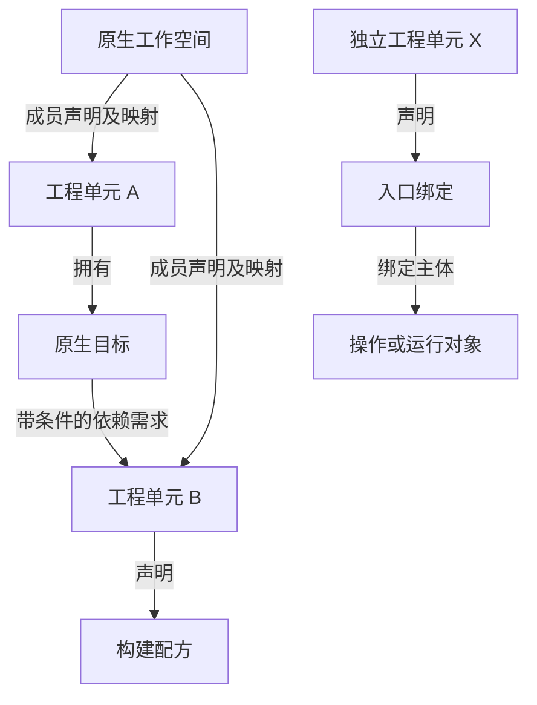

# 基于 Rust、C++、Python 案例的语言无关分层语义事实领域模型定义

日期：2026-11-01。状态：**案例驱动的模型定义建议，供评审**。

本文是新的候选基线，不覆盖旧的 software-semantic-domain-model.md，也不是已归档的 OpenSpec 正式规格。用户授权本轮形成定义；纳入项目权威规格仍需后续 SDD 流程。

## 1. 目标、方法与证据范围

目标是以统一模型表达多个独立软件工程单元、工作空间、构建与装配关系、程序接口、行为契约和实现算法，保留跨语言差异对行为的影响，并支持结构化查询及伪代码可读表达。

主代理选择三个真实 GitHub 项目，取得固定提交的20份文件，通过工具读取与行号检索建立证据。未全量克隆，未执行构建、安装、测试或宏展开；读取到测试断言不代表测试已经通过。三项目的选样不能证明任意软件语义都已覆盖。

| 案例 | 固定提交 | 取样及选择理由 |
| --- | --- | --- |
| rust-lang/regex | `94ac45b2a6e7b1c30927feb5b66c5ded5b7ad447` | 6文件；Cargo根包与多成员工作空间、条件依赖、显式栈算法、绑定与内部可变性 |
| nlohmann/json（C++） | `9c349b1d7c393c6bc6dbbe4191e332e3bb4100b8` | 5文件；INTERFACE与ALIAS、OBJECT目标、独立集成工程、事件式解析器 |
| pallets/click | `2247b35ea1c47c727d7a06e51fa280e12a863ff6` | 9文件；独立打包示例、脚本入口、闭包与装饰器、动态导入、参数分配算法 |

R/C/P证据编号在第17节列出，编号后的行号用于定位。提交号仅固定本次研究证据，不要求产品提供历史查询，也不参与项目身份构造。

## 2. 三类边界与 DDD 的使用方式

必须区分：分析系统的实现职责、被分析软件的工程组织、语义事实的抽象与描述尺度。

采用DDD的统一语言、身份区分和不变量分析方法。本文不把战略、战术、应用、基础设施等架构职责当作软件语义层，不要求被分析软件本身采用DDD。限界上下文、聚合、仓储接口与事务边界不是本次案例能直接确定的事实，留给实现设计及一致性需求验证。

公共模型使用类型化主体、关系、条件、证据及结构化行为；“关系图”表示逻辑关联，不指定图数据库。算法结构也不意味着立即创造一种完整编程语言。

## 3. 从案例到分层的推导

| 案例差异 | 必须分开的语义问题 | 对层界的影响 |
| --- | --- | --- |
| regex根清单同时有包和workspace；Click示例另有项目清单 | 谁是工程单元，谁组织协作；谁声明构建与发布 | 工程组织不能与构建装配完全等同 |
| C++ INTERFACE、ALIAS；Python脚本与wheel | 如何组合与暴露能力，不等于代码本体或实际产物 | 装配交付独立于结构接口 |
| Rust `parse(&self)`内部可变；Click装饰器返回Command | 签名与访问形态不足以说明状态、结果和失败 | 接口结构与行为契约分开记录 |
| C++接收器错误返回；Rust显式栈；Python双端参数消费 | 可观察行为与实现步骤不是同一陈述 | 操作契约与算法机制分开 |

因此采用五个默认语义组织层。这里的“层”是语义问题和事实归类尺度，**不是包含树、强制相邻依赖或自动细化链**。只有某项投影明确规定输入、输出、保留与省略内容，才讨论抽象细化。

三宽视图和四层方案仍是有效替代：前者边界承诺少，后者合并结构接口与行为契约；五层的收益是能分别规定各类事实的判定与查询边界，代价是需要维护谓词归类与跨层引用。不能声称五层是唯一或普适最优解。

## 4. 分层定义

| 层 | 名称与问题 | 核心事实 | 排除的混同 |
| --- | --- | --- | --- |
| E0 | 工程组织与协作：有哪些工程单元，如何协作？ | 项目边界依据、项目身份、原生工作空间、成员声明、协作集合 | 仓库≠项目；目录嵌套≠成员；无workspace仍有E0项目事实 |
| E1 | 构建装配与交付：依赖什么，怎样组合、配置和暴露？ | 目标、构建配方、条件、依赖需求与解析、包发行规格、别名、入口、产物规格 | 目标≠产物；别名≠新实现；入口≠发行包；声明≠已激活/已构建 |
| E2 | 程序结构与接口：主体是什么，以什么结构访问？ | 模块、命名空间、类型、声明、成员、签名、访问约束、名称绑定 | 文件≠模块；名称≠身份；签名不自动说明副作用 |
| E3 | 操作行为契约：在什么前提下产生什么可观察行为？ | 输入域、结果、错误、状态效果、调用协议、资源/时序/并发约束 | 规范要求≠当前实现；可能发生≠本次已发生 |
| E4 | 实现算法与局部语义：通过哪些步骤形成行为？ | 算法、步骤、表达式、绑定、控制流、数据流、调用、捕获、状态迁移及伪代码 | 伪代码摘要≠完整展开；结构完整≠实现等价证明 |

各层均可引用其他层的主体。实现机制可能跨多个操作或项目；行为契约也可约束多个实现。配置、来源、条件、模态、覆盖与冲突贯穿全部层，不另设“可信度层”。

### 4.1 事实归类规则

1. 主体只登记一次；身份与事实层号分开。
2. 语义谓词目录为每个语义原子谓词指定一个 `primaryLayer`，该值用于组织与查询，不参与主体身份。
3. 跨层关系仍是单一事实。例如 `build.entry_binds` 归E1，但可引用E2操作或运行对象；不把它复制到E2和E3。
4. 复合陈述拆成原子事实并用描述对象或关系关联。例如“装饰器将函数转成可执行命令”拆成调用、对象构造、callback关联、入口绑定和效果。
5. 源码、接口、契约、算法的对应可以是多对多；不能按目录或函数数量自动推导层级。

## 5. 统一语言与主体目录

下列为公共模型概念；源语言不必使用同名词。

| 主体或值 | 定义与关键内容 | 典型归类 |
| --- | --- | --- |
| SourceRepository | 来源容器；地址等为定位信息，不代表项目边界 | 证据元数据 |
| Project | 有明确工程边界依据的软件工作单元；独立定义/构建/使用能力与自治治理分开陈述 | E0 |
| ProjectBoundaryAssessment | 项目边界的依据与不确定部分；可先登记候选，确认状态不由清单存在自动推出 | E0 |
| NativeWorkspace | 构建或开发工具原生声明的成员与协调规则 | E0 |
| CoordinationGroup | 分析者或用户显式指定的协作集合，不冒充原生workspace | E0 |
| WorkspaceMembership | 工作空间及成员引用、角色、条件和来源；不转移成员所有权 | E0 |
| PackageSpecification | 发布或解析单元的名称、坐标、版本需求、内容映射；代码命名空间另行表达 | E1 |
| BuildRecipe | 可定位的构建过程声明：后端、工具要求、输入/输出规格与配置 | E1 |
| BuildTarget | 上游工程中明确可选择的逻辑构建单元；允许接口、对象、程序、库或自定义种类 | E1 |
| TestTask / ExecutionTask | 测试或执行单元；可关联目标和先后规则，不自动当作原生构建目标 | E1；运行协议引用E3 |
| TargetAlias | 指向目标的名称绑定，保留名称但归一目标身份 | E1 |
| EntrypointBinding | 外部入口名称到操作、对象或动态解析规则的映射 | E1 |
| OutputSpecification | 声明预期产生或提供什么；包括非文件接口能力 | E1 |
| ArtifactObservation | 有实际记录支持的产物存在陈述，关联规格、配置与证据 | E1；本轮无此类观测 |
| DependencyRequirement | 消费方声明的提供方需求、用途、阶段、条件和约束 | E1 |
| DependencyResolution | 在配置与可见范围下，将需求对应到提供方/候选的结果 | E1 |
| ProgramUnit / Declaration | 模块、类型、操作、变量及匿名声明等程序主体 | E2 |
| CallableDescription | 可调用结构及签名；命名函数、匿名函数、包装函数与运行实例不混同 | E2 |
| OperationContract | 操作在指定前提、条件和观察边界下的结果、错误与效果主张 | E3 |
| State / Resource / Interaction | 状态、资源与参与方身份及其关联；契约和步骤分别引用 | E3/E4谓词投影 |
| AlgorithmDescription | 算法问题、输入输出、行为目标、结构化步骤、实现引用和省略边界 | E4 |
| Binding / BehaviorRegion / Step | 局部绑定、行为区域和算法步骤；匿名也可独立引用 | E4 |
| TransformationApplication | 程序生成/变换应用及输入输出来源映射 | 按定义/装配/行为谓词跨层关联 |
| MetadataApplication | 元数据附着事实及被证实的处理效果 | 按附着和效果谓词分层 |

不是表中每种类型都必须成为DDD实体或聚合根；身份需独立引用时设主体，按内容判等的条件、签名、参数模式等设值对象。证据不足的类型不因目录列出而自动产生实例。

### 5.1 项目边界的本次解释规则

以清单位置为线索，再结合名称、源代码范围、构建配方、目标/入口定义和使用方式，形成带依据的工程单元解释。此规则支持“可独立构建/打包单元”，不据此声称团队自治、版本治理或部署独立。

- regex根包及成员包各保留Cargo包身份。若按其清单与源范围登记对应Project，必须记录包→工程单元的映射依据；不能把Cargo术语无条件变成所有语言的项目定义。
- C++根工程和 `DummyImport` 有不同project声明及配置入口，保留工程定义身份；嵌入配置关系不抹除其来源工程。
- Click及complex示例有各自发行和构建声明，支持独立可打包单元解释；其维护自治未获证。
- 包发行坐标、导入模块名、脚本名、工程名可以相同，也可以不同；分别记录，不按字符串相等合并。

## 6. 身份、归属与上下文

规范性要求：

- `SubjectId`由明确身份要素与归属域建立；名称、文件路径、行号、内容摘要均不能单独替代身份。
- 提交和内容摘要只标识本次证据，项目不因新提交自动获得新身份。
- 项目内主体引用携带项目归属域；workspace和分析集合使用各自身份域。
- 目标别名保留名称绑定身份，解引用到同一目标。匿名操作及不同包装操作不能因缺名称而合并。
- 解释环境影响主体指称时，使用上下文限定引用；仅影响事实取值时，可在同一主体上记录条件化事实。不能默认所有配置都复制整套主体。
- 跨项目算法的管理归属与参与范围分开。实现关联可指向多个项目；无自然管理项目时允许归属未决，不创建虚构项目/workspace。
- 重命名、移动、重载、宏展开重复实例的身份规则按主体类型定义；无法判定连续性时报告歧义，不强行合并。

上下文至少可表达主机/产物平台、目标、构建选项、特性、语言模式、解释阶段和外部环境约束。上下文不是任意无语义字典：各键应有类型和取值规则；未规范化条件引用来源并明确限制。

## 7. 独立项目、工作空间与目标

一个Project可没有workspace，也可拥有多个目标或配方。原生workspace按上游成员规则登记，分析者的任意项目集合使用CoordinationGroup或AnalysisScope。源生workspace的成员若是包，通过明确包映射关联工程单元，不抹去原始成员种类。

根清单同时声明包和workspace时，两种角色都保留。regex有六个显式成员条目，根包也不能被忽略；只数六行列表不等于完整成员数已经由工具解析确认。

项目拥有其原生目标，workspace成员关系不转移所有权。对“构建所有成员”的命令先判断其是选择器、测试编排还是独立定义单元；本轮没有证明必须扩展为workspace拥有目标。遇到实际无法归属的独立定义单元时保留缺口，不把约束当作伪造项目的理由。

Python无原生显式Target时，登记BuildRecipe、PackageSpecification、OutputSpecification和EntrypointBinding；不制造虚假的原生Target。若未来建立规范化分析目标，必须标记其派生身份与来源，不与上游目标混用。



这是公共表达示意，不宣称图中A/B/X对应真实仓库之间已解析的依赖。

## 8. 依赖、解析与观测

依赖按消费方→提供方定向，区分项目/包需求、目标使用要求、构建工具需求、链接/资源关系和代码调用。测试fixture先后不是链接边；目录包含不是依赖；ALIAS归一不是另一条真实库依赖。

需求声明与解析结果分开；一个需求可在不同配置下产生不同结果。需求身份不随查询范围变化。版本需求与本地路径分别保留：regex的path+version不是只有版本的一条边；complex的 `click>=8.1` 没有本地路径声明，不能直接连到当前检出的Click主体。

解析状态：resolved、unresolved、ambiguous。它与相对查询/分析范围的位置inside、outside、unknown正交。若解析只在局部范围进行，应记录解析可见范围，不能把局部未解析当作全局不存在。

条件图允许原样保存循环；只有相关条件可同时满足时，才报告可发生的环。是否违规由对应构建规则判定。本轮没有实际循环案例，以下是表达要求而非已完成循环验证。

声明的输出规格不等于实际产物。INTERFACE目标可传递使用要求；ALIAS无独立实现；Python入口是安装或装配映射，不是wheel文件。实际构建/安装后证据才可支持ArtifactObservation。

## 9. 谓词目录与层间关系

这是首批规范性谓词，后续可在保留含义与类型约束的前提下扩展。不同层的“需要”使用不同限定名，不能共用一个含义不明的requires。

| 谓词 | 主层 | 参数与含义 | 关键约束 |
| --- | --- | --- | --- |
| engineering.defines_project | E0 | declaration, project | 记录边界解释依据，不自动证明治理自治 |
| engineering.workspace_member | E0 | workspace, member, sourceMapping | 原生成员种类及工程映射明确；不推出依赖 |
| engineering.group_member | E0 | coordinationGroup, project | 不冒充原生workspace |
| build.declares_target | E1 | project, target | 目标有唯一明确管理归属；非原生派生目标标记来源 |
| build.declares_recipe | E1 | project, recipe | Python可有配方而无原生目标 |
| build.alias_of | E1 | alias, target | 别名解析不产生第二个目标实现 |
| build.requires | E1 | consumer, requirement | 需求具备用途、阶段、条件与约束 |
| build.resolves_to | E1 | requirement, provider, context | 附解析依据；多配置结果可不同 |
| build.provides_usage | E1 | target, usageRequirement | 表达接口目标提供的包含路径、语言能力等 |
| build.declares_output | E1 | producer, outputSpec | 不推出已构建 |
| build.observed_artifact | E1 | outputSpec, observation | 必须有产物观察证据 |
| build.entry_binds | E1 | entryName, subjectOrResolver | 区分静态引用、动态规则和实际运行绑定 |
| build.precedes | E1 | task, task, orchestrationContext | 不与链接、调用混用 |
| program.contains | E2 | container, declaration | 声明组织，不任意跨种类传递 |
| program.has_signature | E2 | operation, signature | 不推出纯函数或无副作用 |
| program.accessible_under | E2 | declaration, accessConstraint | 用可访问主体/条件表达，不简单映射修饰符等级 |
| contract.precondition | E3 | operationOrAlgorithm, condition | 区分要求与已检查的条件 |
| contract.outcome | E3 | operationOrAlgorithm, outcome | 正常/错误/终止结果及成立条件 |
| contract.effect | E3 | operationOrAlgorithm, effect | 状态、资源、外部交互及观察边界 |
| contract.ordering | E3 | participants, orderingConstraint | 可表达偏序，不强制串行 |
| behavior.implemented_by | E4 | operationOrContract, body | 表达实现关联，不证明等价 |
| behavior.calls | E4 | callSite, callableOrCandidates | 保留分派方式和解析程度 |
| behavior.binds | E4 | introduction, binding, initializer | 一次引入可建立多个绑定 |
| behavior.captures | E4 | closure, bindingOrLocation, mode | 捕获方式未知必须明确 |
| behavior.reads / writes | E4 | step, location | 区分别名、引用和复制 |
| behavior.control_edge / data_edge | E4 | step, step, edgeKind | 分支条件、数据角色明确 |
| behavior.algorithm_described_by | E4 | implementationRefs, algorithmDescription | 描述目的、粒度和省略项明确 |
| behavior.projects_to_pseudocode | E4 | algorithmBody, pseudocodeView | 保留步骤对应，不自动证明语义等价 |
| provenance.generated_from | 不适用（来源元数据目录） | generatedSubject, application, sourceRefs | 允许多对多与无直接源码区间 |

`contains`、`declares`、`member`、`alias`、`binding`和`implements`不互相替代。只有定义了具体语义保留关系和证明/分析依据时才增加 `refines`；不能对相邻层默认连refines边。

## 10. 事实语法与解释规则

以下为抽象语法和字段语义，不指定数据库；正式JSON Schema与全量谓词注册表是下一阶段工件。定义不是“任意主体＋任意字符串”的三元组袋。

```text
SubjectRef  ::= { id, kind, ownershipScope, interpretationContext? }
TypedValue  ::= Scalar | Enum | SubjectRef | Sequence | Record | Expression
Argument    ::= { role, value: TypedValue }
Condition   ::= True | False | Unknown(reasonRef)
              | Compare(operator, operands)
              | All(Condition*) | Any(Condition*) | Not(Condition)
              | SourceCondition(sourceRef, interpretationGapRef)
Fact        ::= { factId, predicateId, arguments: Argument+,
                  applicability: Condition, claimMode, evidenceRefs,
                  derivation? }
Predicate   ::= { predicateId, catalog: Semantic|Provenance, meaning,
                  argumentRoles, argumentTypes, cardinalityRules,
                  constraints, primaryLayer? }
Evidence    ::= { evidenceId, sourceRef, locator, method,
                  role: Supports|Refutes|Limits, premiseFactRefs? }
Coverage    ::= { scopeRef, subjectKinds, predicateFamilies, contextRef,
                  inspectedInputs, excludedInputs, acquisitionState, gaps }
```

问号表示可选字段；加号表示至少一项；星号表示零或多项。`Record`必须由对应谓词值类型定义字段，不允许任意扩展绕过公共目录。

- `claimMode`至少区分 declaration（来源声明）、specification（规范要求）、static_may（静态可能）、static_must（有充分前提的静态必然）、observation（具体观测）、interpretation（明确的解释或抽象）。模式不组成可信度高低阶梯。
- `method`记录直接读取、工具分析、规则推导、人工/代理抽象、构建或运行观察；与claimMode分开。
- evidence中的支持与反驳不自动转换成真假字段。事实记录可以承载待确认主张；查询保留冲突与缺口，不默认裁真。
- 单字段为空只说明未携带；已确认没有、未获取、不支持、不适用各有覆盖或缺口说明。
- Semantic目录中的谓词必须定义E0–E4之一的`primaryLayer`，由目录取得，不由每条事实随意填写。Provenance目录中的来源对应关系不参与语义主层归类，省略`primaryLayer`；它们作为横贯元数据关联各层事实。
- 解析语法合法仍须校验角色类型、引用、基数、作用域和条件；结构校验也不能证明事实为真。

### 10.1 案例化事实示例

下例ID是本研究局部示例，不是已分配的生产ID；它记录原始声明，未声称已执行解析或构建。

```json
{
  "factId": "F-C-ALIAS",
  "predicateId": "build.alias_of",
  "arguments": [
    {"role": "alias", "value": {"kind": "TargetAlias", "id": "C:nlohmann_json::nlohmann_json", "ownershipScope": "C:root"}},
    {"role": "target", "value": {"kind": "BuildTarget", "id": "C:nlohmann_json", "ownershipScope": "C:root"}}
  ],
  "applicability": {"kind": "Compare", "operator": "eq", "operands": [{"contextKey": "NLOHMANN_JSON_TARGET_NAME"}, "nlohmann_json"]},
  "claimMode": "declaration",
  "evidenceRefs": ["C1:79-82", "C1:150-151"]
}
```

本例显式附默认目标名条件，避免忽略可覆盖名称。生产身份规则不能仅取这里演示的名称字符串。

## 11. 宏、元数据、匿名操作和绑定

| 构造 | 公共描述 | 本轮证据及限制 |
| --- | --- | --- |
| 宏/程序生成 | 变换定义、应用、输入、生成主体及来源映射；生成后的行为继续用普通语义事实表达 | Rust `vec![]`的源码应用可见，未执行展开，不能补造展开AST和生成调用 |
| 条件属性/元数据 | 附着主体、参数、适用阶段；解释后形成条件或被证实的效果 | Rust `cfg(test)`与C++编译定义提供条件案例；未覆盖Java注解处理，不能把Python装饰器泛化为静态注解 |
| Lambda/闭包 | 匿名操作、签名、可调用值构造、捕获对象/位置、捕获方式、调用及生命周期 | Rust比较闭包与Python嵌套包装函数可见；运行实例和完整捕获布局未获取 |
| let/绑定 | 绑定引入、初始化、模式、作用域、可变性、路径可用条件 | Rust let/if let及?分别表达绑定、判定和错误传播；关键字本身不是DDD实体 |
| 装饰器/包装 | 装饰器调用、对象构造、返回替换、callback关联、名称绑定与效果 | Click command返回Command；原函数、包装函数、Command对象不应被合并 |

一个语法节点可对应多个公共操作，一个公共算法可跨多个语法位置。源码区间、宏展开位置、动态对象和解释主体不能一对一硬绑。缺少运行/展开依据时保留候选或UNKNOWN，并指明对可达性、绑定或算法覆盖的影响。

## 12. 算法结构与伪代码定义

`AlgorithmDescription`必须包括：身份、描述目的、问题范围、输入输出、前后置/错误/效果、适用上下文、结构化body、实现引用、证据、抽象规则和省略项。描述目的分规范、当前实现解释、抽象算法；三者不能互相覆盖。

结构化体使用以下构造：顺序、绑定/赋值、带类型计算、选择、循环、调用、结果返回、失败/异常处理、资源操作、并发/同步以及UNKNOWN。每个步骤有算法域内唯一stepId；分支和循环体组成BehaviorRegion；控制/数据关系按类型引用步骤。

基础语义约束：绑定与赋值分开；表达式求值顺序及数值规则明确；异常与错误返回分开；控制转移指明目标区域；资源和外部效果不可在摘要中静默丢弃；并发用偏序而非虚构唯一序列。条件或被调用主体未知时，不能以默认成功代替。

伪代码是结构化描述的可读投影。以下均为选定函数/区域的源码解释摘要，未作运行验证或等价证明。未展开的子过程通过引用保留，不能把有省略项的摘要称作完整项目算法。

### 12.1 Rust：显式栈遍历（R5:205–251）

输入：AST根与Visitor；结果/错误类型由Visitor决定。改变局部栈并调用外部提供的回调；回调可有额外效果，不能断言算法纯。

```text
清空节点栈与字符类栈；调用 visitor.start()
重复：
    调用 visitor.pre(current)，失败则立即传播
    frame = induct(current, visitor)，失败则立即传播
    若 frame 存在：
        保存(current, frame)；current = frame.child
        继续外层循环
    调用 visitor.post(current)，失败则立即传播
    重复：
        若节点栈空：返回 visitor.finish()
        (parent, frame) = 弹栈
        nextFrame = pop(frame)
        若 nextFrame 存在：
            按nextFrame种类调用分支/连接的中间回调，失败则传播
            current = nextFrame.child；保存(parent, nextFrame)
            退出内层循环
        调用 visitor.post(parent)，失败则立即传播
```

省略：induct、pop和字符类子遍历的内部实现，均在R5其他区域有源码。不能据此推断所有AST变体、复杂度或回调顺序已形式证明。

### 12.2 C++：SAX入口与结束处理（C5:161–222、565–572）

输入：接收器与strict（默认true）；内部解析会消费输入并调用接收器。接收器错误处理是否抛出及返回什么，取决于接收器。

```text
检查接收器所需接口
ok = sax_parse_internal(receiver)
若 ok 为 false：返回 false
若 strict：
    token = 读取下一token
    若 token 不是EOF：
        构造位置、token与语法错误说明
        返回 receiver.parse_error(...) 的结果
否则：
    释放词法前瞻，使调用者继续使用输入
返回 true
```

错误回调结果不能强写为false。此摘要是sax_parse路径，不替代DOM解析路径；内部数组/对象状态栈、词法分析、尾逗号条件等未展开。

### 12.3 Python：位置参数分配（P7:51–108）

输入实参序列和每位置消耗规格；复制为双端队列，不修改调用者原序列。缺项使用UNSET；负规格为通配；多通配抛TypeError。输入域超出类型约定的行为不在此描述范围。

```text
A = 实参双端队列；N = 规格双端队列；R = 空列表；star = 无
FETCH():
    若A空：返回UNSET
    若star无：从A左取；否则从A右取
当N非空：
    n = star无时从N左取，否则从N右取
    若n==1：向R追加FETCH()
    若n>1：取n项；star存在时反转此组；以元组追加R
    若n<0：
        若star已存在：抛TypeError
        star = R长度；追加UNSET占位
    若n==0：不消费A、不追加R（该规格已从N消费）
若star存在：
    R[star] = A剩余项的元组；清空A
    反转R中star之后的结果段
返回(R的元组，A的列表)
```

它不执行完整CLI选项解析、类型转换或命令调用。测试文件中读取到的其他断言不能替代此算法的已执行测试结果。

## 13. 跨案例映射与反例验收

| 编号 | 案例/反例 | 模型应表达的结果 | 本轮证据状态 |
| --- | --- | --- | --- |
| A01 | 根Cargo既是package又是workspace | 两种角色分别登记，根包不因列表未单列而丢失 | R1声明已读 |
| A02 | Regex多清单和路径依赖 | 包身份、工程映射、成员与依赖分开 | R1–R4已读；未运行metadata |
| A03 | C++ INTERFACE | 目标和使用要求存在，不生成虚构二进制 | C1:150–178已读 |
| A04 | C++ ALIAS | 两个名称引用同一目标实现 | C1:150–151、C4:13–17已读 |
| A05 | C++ OBJECT与测试fixture | 对象目标、测试任务、先后和消费关系分开 | C2、C3已读；未构建 |
| A06 | DummyImport嵌入库工程 | 独立工程声明及配置包含可同时存在 | C4:3–23已读 |
| A07 | complex独立打包定义 | 可打包单元解释有依据，治理自治仍未知 | P2已读 |
| A08 | complex的click>=8.1 | 版本需求不自动绑定本地检出 | P2:6–8已读；未安装解析 |
| A09 | 脚本名/模块/发行包 | 三种身份与入口对象分别关联 | P2:1–18已读 |
| A10 | 装饰器与动态子命令 | 保留生成对象、callback及动态解析规则 | P4:31–45、P6:217–255已读 |
| A11 | parse(&self)内部状态变化 | 签名和效果分别表达，不把借用形态等同纯性 | R6:137–148、379–393已读 |
| A12 | SAX错误回调返回 | 保留接收器结果，不武断改成false | C5:205–222、565–572已读 |
| A13 | Python规格0 | 消费规格但不消费实参；不遗漏分支 | P7:77–108已读 |
| A14 | 已解析依赖在范围外 | 解析状态与范围位置正交，范围变化不改身份 | 规则反例，未进行真实解析 |
| A15 | 同源码不同配置/多次宏展开 | 引用保持解释上下文；实例可区分 | 本轮未展开；待验证 |
| A16 | 多workspace、循环、跨项目算法 | 允许表达且不伪造组织；条件与来源保留 | 三样本未提供充分验证 |

本表“已读”是来源事实证据，不等于实现验证通过。A14–A16明确是尚需补充的反例验收，不冒充从样本得出的普遍结论。

## 14. 覆盖完整性的边界

模型定义应覆盖从工程到实现的语义需求；某个项目的实际事实覆盖则按scope、谓词族和上下文逐项报告。不能以五层均有一条事实证明完整。

E3/E4还需支持错误恢复、状态生命周期、资源、并发同步、时间、外部I/O、权限及信任边界等事实；本轮没有这些类别的充分案例，定义允许其类型化扩展，不声称已完成全目录或所有语言的验证。Java注解、复杂宏展开、多workspace及真实条件循环需要新样本补证。

只有当前来源足以支持某项否定，才能报告不存在；未获取、暂不支持、不适用和冲突分开表达。静态可能、规范要求和实际观测不自动互相反驳，比较前先对齐主体、输入、条件、模态和观察范围。

## 15. Battle记录、取舍与最终修订

四个专业代理以独立上下文首轮阅读，分别进行源码与模型分析；第二轮交换事实、候选层法及反例，最后由第五个独立代理综合评审。主代理记录摘要，不按票数裁决。

| 角色 | 首轮立场 | 第二轮修订或保留意见 |
| --- | --- | --- |
| Rust案例 | 五种语义粒度，或无固定层事实图 | 接受E0–E4查询尺度；不同意统一refines链；强调根包与宏/绑定证据限制 |
| C++案例 | 配置工程→目标→接口契约→算法约四尺度 | 保留四尺度建议，合并E2/E3；目标、测试任务、别名必须区分；核对SAX回调结果 |
| Python案例 | 工程→结构入口→绑定行为→算法，偏可合并视图 | 不赞成固定填满五层；无native target不伪造；纠正规格0的消费对象；项目自治不确定 |
| 独立模型挑战 | 三类关系视图，细层仅作查询尺度 | 保留少数意见：独立查询不证明本体层级；建议三宽视图＋可选尺度；指出未验证边界 |
| 独立综合评审 | 在两轮后进入 | 建议五个默认组织层；不建强制细化链；无workspace不删除E0；保留替代方案 |

主代理接受综合评审的组织建议，并保留三/四层异议及取舍。五层用于定义与导航，不是多数表决所得的世界本体定律。

综合评审初稿曾建议主体身份限定仓库修订，主代理质询其与稳定身份的冲突；评审已撤回该表述：commit仅固定来源，主体身份由归属域和明确要素构造。又明确了命名空间化谓词、primaryLayer及复合事实拆解，避免跨层重复主体。

交付前独立评审未发现阻断问题；其指出来源关系“横贯”不应冒充主层，已以Semantic/Provenance两类谓词目录和条件必需的primaryLayer规则修正。此评审是静态核对，不是全量语义验证。

本轮领域定义状态为proposed，未修改既有草案、配置包、正式规格或实现。用户批准后再通过SDD变更落地事实目录、Schema、谓词校验、算法语法与验收集；本文不声称这些执行工件已经实现。

## 16. 本阶段可采用的定义与后续事项

可评审的基线已经形成：E0–E4的语义边界、主体与身份规则、工程/成员/目标模型、依赖需求与解析分离、首批谓词、事实抽象语法、算法结构和三项源码伪代码投影。

仍需工程化的部分：完整词汇注册表与类型编码、每种主体的身份要素、条件和操作语义的机器可执行定义、跨事实校验、来源有效性校验、全量获取与覆盖矩阵。后续规格不能只写“采用DDD”或“支持五层”，应逐项规定上述约束和反例通过条件。

## 17. 固定来源索引

- **R1** [rust-lang/regex/Cargo.toml](https://github.com/rust-lang/regex/blob/94ac45b2a6e7b1c30927feb5b66c5ded5b7ad447/Cargo.toml)；Git blob `0078c2e23be222087c7fd7fd00717e986b9debea`。
- **R2** [rust-lang/regex/regex-cli/Cargo.toml](https://github.com/rust-lang/regex/blob/94ac45b2a6e7b1c30927feb5b66c5ded5b7ad447/regex-cli/Cargo.toml)；Git blob `51ac16eeaa50df6cd601d56d411122266150aa22`。
- **R3** [rust-lang/regex/regex-syntax/Cargo.toml](https://github.com/rust-lang/regex/blob/94ac45b2a6e7b1c30927feb5b66c5ded5b7ad447/regex-syntax/Cargo.toml)；Git blob `fa63da971e717d8fd19fecd8a25e05a694416607`。
- **R4** [rust-lang/regex/regex-lite/Cargo.toml](https://github.com/rust-lang/regex/blob/94ac45b2a6e7b1c30927feb5b66c5ded5b7ad447/regex-lite/Cargo.toml)；Git blob `b230501b92a2e94b41c95d3aaf4e8a63cb7a6b9a`。
- **R5** [rust-lang/regex/regex-syntax/src/ast/visitor.rs](https://github.com/rust-lang/regex/blob/94ac45b2a6e7b1c30927feb5b66c5ded5b7ad447/regex-syntax/src/ast/visitor.rs)；Git blob `36cd713c0f3dc60d062adbf1709a3fe0120baba5`。
- **R6** [rust-lang/regex/regex-lite/src/hir/parse.rs](https://github.com/rust-lang/regex/blob/94ac45b2a6e7b1c30927feb5b66c5ded5b7ad447/regex-lite/src/hir/parse.rs)；Git blob `1983a9b89ed7f7bfca570d7f587b728e372be1b3`。
- **C1** [nlohmann/json/CMakeLists.txt](https://github.com/nlohmann/json/blob/9c349b1d7c393c6bc6dbbe4191e332e3bb4100b8/CMakeLists.txt)；Git blob `1369b973ea454923e58e17a0f77ef72cbe7b0be9`。
- **C2** [nlohmann/json/tests/CMakeLists.txt](https://github.com/nlohmann/json/blob/9c349b1d7c393c6bc6dbbe4191e332e3bb4100b8/tests/CMakeLists.txt)；Git blob `f4e574fc13b85acba48126390f14d7a7d8ab4ff4`。
- **C3** [nlohmann/json/tests/cmake_add_subdirectory/CMakeLists.txt](https://github.com/nlohmann/json/blob/9c349b1d7c393c6bc6dbbe4191e332e3bb4100b8/tests/cmake_add_subdirectory/CMakeLists.txt)；Git blob `0b82d914175261efdfe0c13a6aa354fd01356d3b`。
- **C4** [nlohmann/json/tests/cmake_add_subdirectory/project/CMakeLists.txt](https://github.com/nlohmann/json/blob/9c349b1d7c393c6bc6dbbe4191e332e3bb4100b8/tests/cmake_add_subdirectory/project/CMakeLists.txt)；Git blob `ff8838e6d776148b2c32bebf3b44090029b1f6ba`。
- **C5** [nlohmann/json/include/nlohmann/detail/input/parser.hpp](https://github.com/nlohmann/json/blob/9c349b1d7c393c6bc6dbbe4191e332e3bb4100b8/include/nlohmann/detail/input/parser.hpp)；Git blob `5bf8f1b6b1791b9412f1d15f3dda3a5e292ad517`。
- **P1** [pallets/click/pyproject.toml](https://github.com/pallets/click/blob/2247b35ea1c47c727d7a06e51fa280e12a863ff6/pyproject.toml)；Git blob `7c9a10b8760ff658ecf3bfc90a12ab138772e4eb`。
- **P2** [pallets/click/examples/complex/pyproject.toml](https://github.com/pallets/click/blob/2247b35ea1c47c727d7a06e51fa280e12a863ff6/examples/complex/pyproject.toml)；Git blob `248f1acbb6140f817983cb11c90c228f9711a36d`。
- **P3** [pallets/click/examples/complex/complex/__init__.py](https://github.com/pallets/click/blob/2247b35ea1c47c727d7a06e51fa280e12a863ff6/examples/complex/complex/__init__.py)；Git blob `e69de29bb2d1d6434b8b29ae775ad8c2e48c5391`。
- **P4** [pallets/click/examples/complex/complex/cli.py](https://github.com/pallets/click/blob/2247b35ea1c47c727d7a06e51fa280e12a863ff6/examples/complex/complex/cli.py)；Git blob `81af075c4b99d2e9497810112cf22e1e77d70839`。
- **P5** [pallets/click/examples/complex/complex/commands/cmd_init.py](https://github.com/pallets/click/blob/2247b35ea1c47c727d7a06e51fa280e12a863ff6/examples/complex/complex/commands/cmd_init.py)；Git blob `8802458a9151a8f27ebc480477f60854c91015da`。
- **P6** [pallets/click/src/click/decorators.py](https://github.com/pallets/click/blob/2247b35ea1c47c727d7a06e51fa280e12a863ff6/src/click/decorators.py)；Git blob `cc42e5d42c48e7bddca9346bc4dd4f240a30c2e3`。
- **P7** [pallets/click/src/click/parser.py](https://github.com/pallets/click/blob/2247b35ea1c47c727d7a06e51fa280e12a863ff6/src/click/parser.py)；Git blob `4fcbf7caa83a474cee2d3ea25da56b0399dd893a`。
- **P8** [pallets/click/tests/test_parser.py](https://github.com/pallets/click/blob/2247b35ea1c47c727d7a06e51fa280e12a863ff6/tests/test_parser.py)；Git blob `f2a3ad5931761ad0da0b4d3d8b7481bfd5f89ebb`。
- **P9** [pallets/click/tests/test_command_decorators.py](https://github.com/pallets/click/blob/2247b35ea1c47c727d7a06e51fa280e12a863ff6/tests/test_command_decorators.py)；Git blob `5bd268c0a60be62ed5b8d667d61ac35bc4c2a6b8`。

全部本地来源字节已按Git blob算法核对，与获取结果一致；未执行其中代码。下附记录用于重现选样，不表示产品支持历史服务。

## 附录A：案例证据清单（机器可读）

```json
{
  "scope": "Selected upstream source/configuration files, not full clones; no builds executed.",
  "files": [
    {
      "repo": "rust-lang/regex",
      "path": "Cargo.toml",
      "commit": "94ac45b2a6e7b1c30927feb5b66c5ded5b7ad447",
      "blob": "0078c2e23be222087c7fd7fd00717e986b9debea",
      "url": "https://github.com/rust-lang/regex/blob/94ac45b2a6e7b1c30927feb5b66c5ded5b7ad447/Cargo.toml",
      "sha256": "e060af2cec7da6c4ea99bb51c59caa6844b0893d9961aa562845c9f672bfbcbc",
      "bytes": 9063
    },
    {
      "repo": "nlohmann/json",
      "path": "tests/cmake_add_subdirectory/CMakeLists.txt",
      "commit": "9c349b1d7c393c6bc6dbbe4191e332e3bb4100b8",
      "blob": "0b82d914175261efdfe0c13a6aa354fd01356d3b",
      "url": "https://github.com/nlohmann/json/blob/9c349b1d7c393c6bc6dbbe4191e332e3bb4100b8/tests/cmake_add_subdirectory/CMakeLists.txt",
      "sha256": "66fa3530304282b310e4a36635ec59c361cbed29eb79b15f9190267f51372924",
      "bytes": 701
    },
    {
      "repo": "nlohmann/json",
      "path": "tests/cmake_add_subdirectory/project/CMakeLists.txt",
      "commit": "9c349b1d7c393c6bc6dbbe4191e332e3bb4100b8",
      "blob": "ff8838e6d776148b2c32bebf3b44090029b1f6ba",
      "url": "https://github.com/nlohmann/json/blob/9c349b1d7c393c6bc6dbbe4191e332e3bb4100b8/tests/cmake_add_subdirectory/project/CMakeLists.txt",
      "sha256": "8186e240007a3ebd3133a31e7e2b3680364a47eeb2ee54f69adc4e8684bedc7f",
      "bytes": 776
    },
    {
      "repo": "pallets/click",
      "path": "pyproject.toml",
      "commit": "2247b35ea1c47c727d7a06e51fa280e12a863ff6",
      "blob": "7c9a10b8760ff658ecf3bfc90a12ab138772e4eb",
      "url": "https://github.com/pallets/click/blob/2247b35ea1c47c727d7a06e51fa280e12a863ff6/pyproject.toml",
      "sha256": "327b296ab1fc9280c106c71efea961f71dffa5d8f69d85a88eba758e0f440636",
      "bytes": 5324
    },
    {
      "repo": "nlohmann/json",
      "path": "tests/CMakeLists.txt",
      "commit": "9c349b1d7c393c6bc6dbbe4191e332e3bb4100b8",
      "blob": "f4e574fc13b85acba48126390f14d7a7d8ab4ff4",
      "url": "https://github.com/nlohmann/json/blob/9c349b1d7c393c6bc6dbbe4191e332e3bb4100b8/tests/CMakeLists.txt",
      "sha256": "9c2ada6df78fd88549c88e38f2ed5a8097d87a1521cbcf4ead04bd167bec13e6",
      "bytes": 21849
    },
    {
      "repo": "pallets/click",
      "path": "examples/complex/pyproject.toml",
      "commit": "2247b35ea1c47c727d7a06e51fa280e12a863ff6",
      "blob": "248f1acbb6140f817983cb11c90c228f9711a36d",
      "url": "https://github.com/pallets/click/blob/2247b35ea1c47c727d7a06e51fa280e12a863ff6/examples/complex/pyproject.toml",
      "sha256": "d7e12fcc656a46f56fa68874987d355c09c0c3a43d7ded4404d0f34bd3715841",
      "bytes": 325
    },
    {
      "repo": "rust-lang/regex",
      "path": "regex-cli/Cargo.toml",
      "commit": "94ac45b2a6e7b1c30927feb5b66c5ded5b7ad447",
      "blob": "51ac16eeaa50df6cd601d56d411122266150aa22",
      "url": "https://github.com/rust-lang/regex/blob/94ac45b2a6e7b1c30927feb5b66c5ded5b7ad447/regex-cli/Cargo.toml",
      "sha256": "4e155a093c5ce837f5cca7ba7c6982ebd8c28ef3351b98fec717aec80efb9c71",
      "bytes": 1239
    },
    {
      "repo": "rust-lang/regex",
      "path": "regex-syntax/Cargo.toml",
      "commit": "94ac45b2a6e7b1c30927feb5b66c5ded5b7ad447",
      "blob": "fa63da971e717d8fd19fecd8a25e05a694416607",
      "url": "https://github.com/rust-lang/regex/blob/94ac45b2a6e7b1c30927feb5b66c5ded5b7ad447/regex-syntax/Cargo.toml",
      "sha256": "fdfdadd590cb4121437df8e9b72f3ca2e6eff812bb9436f2828c76b1810b1f6b",
      "bytes": 2007
    },
    {
      "repo": "pallets/click",
      "path": "src/click/decorators.py",
      "commit": "2247b35ea1c47c727d7a06e51fa280e12a863ff6",
      "blob": "cc42e5d42c48e7bddca9346bc4dd4f240a30c2e3",
      "url": "https://github.com/pallets/click/blob/2247b35ea1c47c727d7a06e51fa280e12a863ff6/src/click/decorators.py",
      "sha256": "16069357615691fcdfc9c794bb515f6009eb35aad6f7a76c017bdce06dae8d55",
      "bytes": 21680
    },
    {
      "repo": "pallets/click",
      "path": "examples/complex/complex/__init__.py",
      "commit": "2247b35ea1c47c727d7a06e51fa280e12a863ff6",
      "blob": "e69de29bb2d1d6434b8b29ae775ad8c2e48c5391",
      "url": "https://github.com/pallets/click/blob/2247b35ea1c47c727d7a06e51fa280e12a863ff6/examples/complex/complex/__init__.py",
      "sha256": "e3b0c44298fc1c149afbf4c8996fb92427ae41e4649b934ca495991b7852b855",
      "bytes": 0
    },
    {
      "repo": "nlohmann/json",
      "path": "include/nlohmann/detail/input/parser.hpp",
      "commit": "9c349b1d7c393c6bc6dbbe4191e332e3bb4100b8",
      "blob": "5bf8f1b6b1791b9412f1d15f3dda3a5e292ad517",
      "url": "https://github.com/nlohmann/json/blob/9c349b1d7c393c6bc6dbbe4191e332e3bb4100b8/include/nlohmann/detail/input/parser.hpp",
      "sha256": "b4facd4c4eb402064b07f27a411adce548b5460a8e3572e1146a18cb23d5024b",
      "bytes": 22448
    },
    {
      "repo": "rust-lang/regex",
      "path": "regex-syntax/src/ast/visitor.rs",
      "commit": "94ac45b2a6e7b1c30927feb5b66c5ded5b7ad447",
      "blob": "36cd713c0f3dc60d062adbf1709a3fe0120baba5",
      "url": "https://github.com/rust-lang/regex/blob/94ac45b2a6e7b1c30927feb5b66c5ded5b7ad447/regex-syntax/src/ast/visitor.rs",
      "sha256": "2af2efd77727803b8d15a6244af92267e96edbfc1a211bcbea2b32e1b5483918",
      "bytes": 19004
    },
    {
      "repo": "nlohmann/json",
      "path": "CMakeLists.txt",
      "commit": "9c349b1d7c393c6bc6dbbe4191e332e3bb4100b8",
      "blob": "1369b973ea454923e58e17a0f77ef72cbe7b0be9",
      "url": "https://github.com/nlohmann/json/blob/9c349b1d7c393c6bc6dbbe4191e332e3bb4100b8/CMakeLists.txt",
      "sha256": "aeebc782870174ff2f334ab2dc11693ecc032fd31ce77c78c3d507c00f590377",
      "bytes": 11412
    },
    {
      "repo": "rust-lang/regex",
      "path": "regex-lite/src/hir/parse.rs",
      "commit": "94ac45b2a6e7b1c30927feb5b66c5ded5b7ad447",
      "blob": "1983a9b89ed7f7bfca570d7f587b728e372be1b3",
      "url": "https://github.com/rust-lang/regex/blob/94ac45b2a6e7b1c30927feb5b66c5ded5b7ad447/regex-lite/src/hir/parse.rs",
      "sha256": "a53435d9f11672a7cc7507ac4d62d52816761afd9a5804d1996a450546c82c42",
      "bytes": 82581
    },
    {
      "repo": "rust-lang/regex",
      "path": "regex-lite/Cargo.toml",
      "commit": "94ac45b2a6e7b1c30927feb5b66c5ded5b7ad447",
      "blob": "b230501b92a2e94b41c95d3aaf4e8a63cb7a6b9a",
      "url": "https://github.com/rust-lang/regex/blob/94ac45b2a6e7b1c30927feb5b66c5ded5b7ad447/regex-lite/Cargo.toml",
      "sha256": "0723a0f2a31737ca59f5a3645bb490f0b7e384133996bb2560a93c12fa9b64e8",
      "bytes": 1062
    },
    {
      "repo": "pallets/click",
      "path": "src/click/parser.py",
      "commit": "2247b35ea1c47c727d7a06e51fa280e12a863ff6",
      "blob": "4fcbf7caa83a474cee2d3ea25da56b0399dd893a",
      "url": "https://github.com/pallets/click/blob/2247b35ea1c47c727d7a06e51fa280e12a863ff6/src/click/parser.py",
      "sha256": "a09f9f53fde6bf1ba022e36d1da0804d9e7a9601261d18208c9892a84818ae30",
      "bytes": 19052
    },
    {
      "repo": "pallets/click",
      "path": "tests/test_parser.py",
      "commit": "2247b35ea1c47c727d7a06e51fa280e12a863ff6",
      "blob": "f2a3ad5931761ad0da0b4d3d8b7481bfd5f89ebb",
      "url": "https://github.com/pallets/click/blob/2247b35ea1c47c727d7a06e51fa280e12a863ff6/tests/test_parser.py",
      "sha256": "9e3a95fb896166e23bb8070de55a7d81a72a95c0b4909da659e54274b1615069",
      "bytes": 915
    },
    {
      "repo": "pallets/click",
      "path": "examples/complex/complex/cli.py",
      "commit": "2247b35ea1c47c727d7a06e51fa280e12a863ff6",
      "blob": "81af075c4b99d2e9497810112cf22e1e77d70839",
      "url": "https://github.com/pallets/click/blob/2247b35ea1c47c727d7a06e51fa280e12a863ff6/examples/complex/complex/cli.py",
      "sha256": "2042ffdb1e77f0f937036f3f0a33c67bacbad90477873d7576cc297674a55de7",
      "bytes": 1608
    },
    {
      "repo": "pallets/click",
      "path": "examples/complex/complex/commands/cmd_init.py",
      "commit": "2247b35ea1c47c727d7a06e51fa280e12a863ff6",
      "blob": "8802458a9151a8f27ebc480477f60854c91015da",
      "url": "https://github.com/pallets/click/blob/2247b35ea1c47c727d7a06e51fa280e12a863ff6/examples/complex/complex/commands/cmd_init.py",
      "sha256": "6068f21b5874685d6e4d467f24bc45ddf2cc28457cd27b1b2dc2aadef24ddde4",
      "bytes": 385
    },
    {
      "repo": "pallets/click",
      "path": "tests/test_command_decorators.py",
      "commit": "2247b35ea1c47c727d7a06e51fa280e12a863ff6",
      "blob": "5bd268c0a60be62ed5b8d667d61ac35bc4c2a6b8",
      "url": "https://github.com/pallets/click/blob/2247b35ea1c47c727d7a06e51fa280e12a863ff6/tests/test_command_decorators.py",
      "sha256": "234ede359da2839923af2436056680bab68bdba622bf596452bbfbe1e1cfd6fa",
      "bytes": 1880
    }
  ]
}
```

## 附录B：Battle结构化摘要

```json
{
  "battle_id": "cross-language-cases-2026-11-01",
  "problem": "由Rust/C++/Python真实项目形成语言无关分层语义事实领域模型",
  "participants": [
    "case_rust",
    "case_cpp",
    "case_python",
    "case_model_challenger",
    "case_final_reviewer"
  ],
  "isolation": "fork_turns=none; independent first-round contexts",
  "rounds": [
    {
      "round": 1,
      "roles": 4,
      "mode": "独立案例与模型分析"
    },
    {
      "round": 2,
      "roles": 4,
      "mode": "交叉事实质询、比较三/四/五层候选"
    },
    {
      "round": "review",
      "roles": 1,
      "mode": "独立综合评审及身份规则最终纠正"
    }
  ],
  "decision_status": "proposed",
  "user_decision": null,
  "recommendation": "五个默认组织层，类型化关系关联，非强制细化链",
  "minority_positions": [
    "四尺度合并结构接口与契约",
    "三宽关系视图＋可选查询尺度"
  ],
  "unresolved": [
    "项目治理自治及完整身份规则",
    "宏展开/注解/多workspace/循环反例未验证",
    "全仓库事实完备性未验证",
    "真实构建/安装/运行未执行"
  ],
  "execution_notes": [
    "精选20文件而非全仓库克隆",
    "源Git blob字节核对通过",
    "未修改旧领域模型/正式规格/代码",
    "当前平台通用协作工具显式分派专业角色，并非Codex自动发现配置验证"
  ]
}
```
