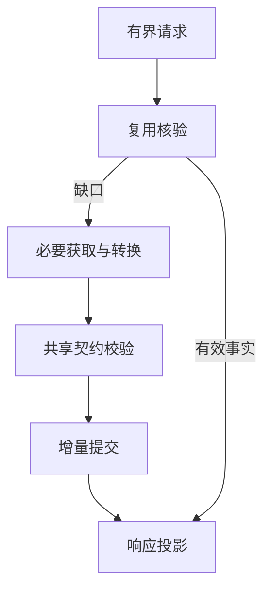

# Design

现行接口接续（2026-11-09，ADR-0014）：本文件M1/V1及旧完整事实运行接口为历史规划/交付记录，当前公开运行协议仅V2，不再提供兼容查询、仓储或转换。通用能力要求继续适用；新实施不得恢复旧API。唯一删除与审核任务见`openspec/changes/redesign-semantic-entity-domain-model/tasks.md`第11节。

## 当前领域模型基准

当前领域模型基准：公共语义实体档案是语义身份/关系/属性/主张的唯一权威来源；工具解析器提供源码构造、观察和证据，实体构造器负责语义映射，查询/存储消费同一实体身份。E0–E4是视角，不对应五层部署。

## M1闭合端口与载体（代理技术决定，m1-project-discovery-1）

M1是项目发现/列表、语言声明、原生workspace成员的有限增量，不是完整所有项目事实。本节装配已有owner，ADR-0009授权/交付2.1–2.3门禁不变；M2–M4未消费类型、全量算法、全平台/负载定值不作M1前置。以下是可冻结审查的切片设计，尚未声明集合冻结或能力实测。

| 唯一记录owner（原change design的M1节） | 生产端口 | 消费方 |
| --- | --- | --- |
| 模型#3：M1Identity/SubjectRef/Registration/Artifact/Evidence/Diagnostic/Assessment/Fact/Coverage/Bundle/Observations | register_m1、validate_model；#10构造记录 | #7/#8/#9/#10/#12/#5 |
| 查询#7：M1Query/Result/Delivery | normalize_m1、project_m1、present_m1 | #8/#12/公开入口、#5 |
| 构造#8：M1Need/Plan | plan_m1 | #10/#12 |
| 存储#9：M1Read/Commit/Receipt | read_m1、commit_m1、lookup_m1、fact_key_m1、canonicalize_m1 | #8/#12/#7 |
| 获取#10：M1Entry/Acquired | acquire_m1 | #12/#11/#5 |
| 质量#5：M1Event/Usage/Profile | profile_m1、compare_m1 | #12产生事件，#11消费档案 |
| Token#11：M1ModelDecision | decide_model_m1 | #10/#12 |
| 协作#12：M1Session | open_m1、verify_m1、current_m1、run_m1、observe_m1 | #8/#9/#10/#5及入口 |

Python3 >=3.11为M1宿主实现的代理选择（TOML/SQLite/标准库JSON），模型校验复用#3固定依赖jsonschema==4.26.0；Cargo为#10所选原生工具，实际版本/平台以M1试验证据绑定，源语言仍Rust/Python；不把实现语言选择冒用户确认。未来`skill/core/contracts/`只重导入/适配各owner记录，不创建第二定义。唯一公开命令`python3 -m c2s_skill query --request REQUEST.json`由core入口读取一次M1Query后run_m1，再present_m1输出M1Delivery，协议/退出码由#7唯一规定；可复用结构化请求，不要求人手写Schema。固定短语适配由#7入口同样规范化，不增加第二查询协议。

未来发行载体为包含skill/README.md、Python包c2s_skill、contracts/semantic-model本切片目录/Schema/manifest及依赖说明的Skill目录归档；原始产品布局skill/query、construction、acquisition、storage、coordination、quality、model职责通过包c2s_skill按相同模块映射，contracts目录按原模型路径打包本地资源，禁止运行期拉未知$ref。具体打包脚本随原架构2.1.1（M1）交付，不在本轮创建。候选产品0.1.0，model version=1.0.0/profile=m1-project-discovery-1，开发工具package.json版本独立；版本元数据随candidate摘要/契约摘要/独立verdict绑定，不提前tag/发布。

F1–F4交接约束：#6在正常化前记录receivedNs，前置失败同样交#5可空query/session的Profile；#5摘要经#9 fact_key_m1获得，策略strategyId及逐项缺口自包含，不读隐式缓存，跨inputId/identityDomain比较明确不可比。#10生产带supersedes的进展，#9保完整历史，#12 current_m1唯一选有效叶，#8规划/#7投影只用该视图。结构有效的未知select保留交#8逐项诊断，经request_diagnostics到#7；提交/lookup成功必须read_m1规范重读后再投影，失败则canonicalize暂存并如实回执。

合并只有三处：#8合必要需求、#9合已存规范主张/证据、#7合两种呈现；#6不实现它们。未知select由#8判定，并经#12交#7呈现，未支持格式由#10覆盖缺口，保存失败由#9回执，#12只能传递，不能凭单success覆盖。M1所选原生接口仍需#10对应M1试验和跨模块审查；隔离门禁未过前不写隐藏suite/产品。冻结此切片只要求所消费记录/签名闭合与真实所选路径证据，不要求全部产品先设计完。

## Context

本提案撰写时产品尚未实现，模型A用于记录主体身份、事实、条件、证据和覆盖候选。现行领域身份主轴由ADR-0012更新为语义实体；本设计中的逻辑职责按实体契约衔接。新设计是候选；职责归属作为授权范围内代理规划决定，不是用户选定部署。

## Goals / Non-Goals

以语义实体身份和类型化关系为跨组件公共对象，按需取得实体属性/关系/实现与验证映射并减少重复工作；E0–E4只作事实观察视角，不按层部署服务或处理管线；不决定存储引擎、实现语言、首期支持或数值性能。

## Decisions

比较：单协调器内聚实现简单，扩展边界易混；模块化逻辑流水线可独立替换获取器但有协调成本。候选采用后者的职责分离，仍可同进程单协调器实现，不预设微服务。每次全模型分析是同质量成本对照，不是默认路径；预先全仓构造具体语义内容违反按需目标；工具已有索引可复用，必要的轻量定位索引是否建立按成本与来源能力评价，不把索引一概当语义构造。

| 职责 | 输入/输出 | 公共定义归属 |
| --- | --- | --- |
| 请求规范化与投影 | 用户意图→有界请求；有效事实→最小响应 | #7；引用主规格 |
| 需求规划/协调 | 请求、可复用记录→必要缺口/结果 | #8计划、#12执行一致性 |
| 实体与证据契约 | 实体/属性/关系身份、条件、主张、诊断/覆盖校验 | 当前语义实体契约；不在各适配器复制 |
| 获取与转换 | 缺口+能力证据→主张、证据、局限 | #10；不自行裁真 |
| 来源有效性 | 来源观察→可用/变化/未核验判定 | #12；#9消费，不把存储命中当有效 |
| 增量持久化 | 经校验且符合政策候选→新增/已存/冲突 | #9；同次固定输入只保存新增内容，跨次政策不自动选择 |
| 质量/Token评价 | 分阶段事件→等质量对照 | #5/#11；不改变事实语义 |

图是逻辑职责，不表示每步必须联网/写库或独立进程。内部扩取需记录依赖理由和边界；不得自动返出。确定性结构化结果先转换，模型仅接未解决语义及必要上下文；没有工具能力证据时不假定替代LLM可保持质量。

语言无关核心仅处理公共契约；适配记录源语言/混合边界、host工具可用性和target配置，未知则披露。模型身份不得因工具/层/平台不同重键；上下文条件按公共实体profile表达。

## Risks / Trade-offs

协调开销可能抵消延迟收益：按#5代表负载测量，不承诺更快。局部上下文漏依赖：#8闭包与#10局限可回退或报告缺口，不无界扩取。并发重复调用：#12合并等价工作但不扩大查询边界。输入归属：同次固定输入不要求源码更新闭环，不混用不适用成果。

## Migration Plan

冻结公共语义后再实施各能力，#7/#8/#9/#10/#11/#12分别拥有任务，不在此重复。候选交付根`skill/core/`仅模块规划，不在本次创建。

## Open Questions

获取能力调研先行接续：#10的`acquisition-survey-2026-11-02/report.md`及能力矩阵比较原生工具、CRG/GitNexus实际Skill、Serena与CodeGraph接口。获取端口允许Skill作为来源，不固定工具→Skill→LLM顺序；公共模型/身份/顶层完整性仍由本项目维护。第三方图社区不能自动成为语义模块边界，图UID不是领域身份；检索/摘要结果不能直接作为完整响应。文档阶段未运行候选，所选接口/覆盖及索引成本证据不足时不能冻结本架构的可实施接口。

能力/版本组合由代理调查，评价方式按ADR-0007优化前后对照；负载实测后定，D03分析内更新前置不再适用；未来部署若影响支持或重大成本必须再审，不以此图决定。

## 固定项目输入约束（ADR-0006）

一次分析期间项目不变；图中的复用核验在本期关注成果属于本分析输入、条件/能力版本与覆盖是否适用，不意味着每次查询重新扫描源码或持续监控。后续查询只补尚未取得内容，跨次输入变化更新另议，不由存储或适配器默选。

## ADR-0007需求基线接续

#7按请求确定顶层完整事实并从同一公共结果生成报告/结构数据；#8查询时启动、同主体只补未完成项；#10可自行选择必要分析操作但保持项目不变；#5/#11如实记录获取/缺口并比较优化前后，不以严格语义金标或用户数值目标为当前前置。目录全部内容纳入范围但不提前取得所有事实。具体契约/工具/模块仍由代理设计，需求确认不等于实现批准。

## ADR-0013 当前约束（2026-11-08）

采用可替换工具适配、事实构造、证据归一、存储和查询职责；不强制DDD或六边形架构。优先复用有证据的开源工具，保留原始输出和解析缺口，不重复自建通用代码图。 依据：`docs/decisions/0013-非DDD语义事实模型.md`。历史执行记录中的DDD或旧模型表述不构成现行约束。本轮只进行文档修订，产品重构完成状态不变。
