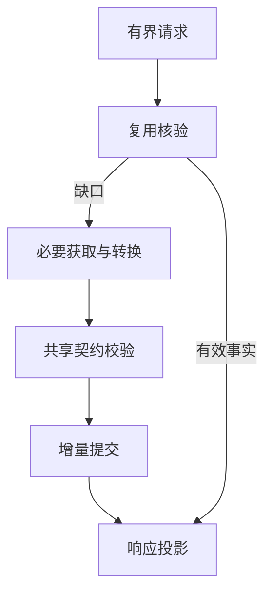

# Design

## Context

现有产品尚未实现；模型A定义主体身份、事实、条件、证据和覆盖候选，正式两份主规格是固定约束。新设计是候选；职责归属作为授权范围内代理规划决定，不是用户选定部署。

## Goals / Non-Goals

统一语义、按需取得、减少重复模型工作；不按五层部署服务，不决定存储引擎、实现语言、首期支持或数值性能。

## Decisions

比较：单协调器内聚实现简单，扩展边界易混；模块化逻辑流水线可独立替换获取器但有协调成本。候选采用后者的职责分离，仍可同进程单协调器实现，不预设微服务。每次全模型分析是同质量成本对照，不是默认路径；预先全仓构造具体语义内容违反按需目标；工具已有索引可复用，必要的轻量定位索引是否建立按成本与来源能力评价，不把索引一概当语义构造。

| 职责 | 输入/输出 | 公共定义归属 |
| --- | --- | --- |
| 请求规范化与投影 | 用户意图→有界请求；有效事实→最小响应 | #7；引用主规格 |
| 需求规划/协调 | 请求、可复用记录→必要缺口/结果 | #8计划、#12执行一致性 |
| 事实与证据契约 | 身份、条件、主张、诊断/覆盖校验 | #3模型A；不在各适配器复制 |
| 获取与转换 | 缺口+能力证据→主张、证据、局限 | #10；不自行裁真 |
| 来源有效性 | 来源观察→可用/变化/未核验判定 | #12；#9消费，不把存储命中当有效 |
| 增量持久化 | 经校验且符合政策候选→新增/已存/冲突 | #9；同次固定输入只保存新增内容，跨次政策不自动选择 |
| 质量/Token评价 | 分阶段事件→等质量对照 | #5/#11；不改变事实语义 |

图是逻辑职责，不表示每步必须联网/写库或独立进程。内部扩取需记录依赖理由和边界；不得自动返出。确定性结构化结果先转换，模型仅接未解决语义及必要上下文；没有工具能力证据时不假定替代LLM可保持质量。

语言无关核心仅处理公共契约；适配记录源语言/混合边界、host工具可用性和target配置，未知则披露。模型身份不得因工具/层/平台不同重键；上下文条件按模型A表达。

## Risks / Trade-offs

协调开销可能抵消延迟收益：按#5代表负载测量，不承诺更快。局部上下文漏依赖：#8闭包与#10局限可回退或报告缺口，不无界扩取。并发重复调用：#12合并等价工作但不扩大查询边界。输入归属：同次固定输入不要求源码更新闭环，不混用不适用成果。

## Migration Plan

冻结公共语义后再实施各能力，#7/#8/#9/#10/#11/#12分别拥有任务，不在此重复。候选交付根`skill/core/`仅模块规划，不在本次创建。

## Open Questions

D01支持组合、D02质量数值；负载范围实测后定，D03分析内更新前置不再适用；未来部署若影响支持或重大成本必须再审，不以此图决定。

## 固定项目输入约束（ADR-0006）

一次分析期间项目不变；图中的复用核验在本期关注成果属于本分析输入、条件/能力版本与覆盖是否适用，不意味着每次查询重新扫描源码或持续监控。后续查询只补尚未取得内容，跨次输入变化更新另议，不由存储或适配器默选。
